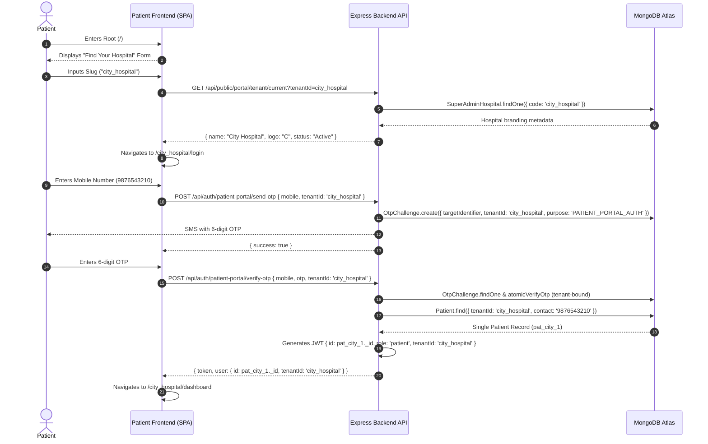
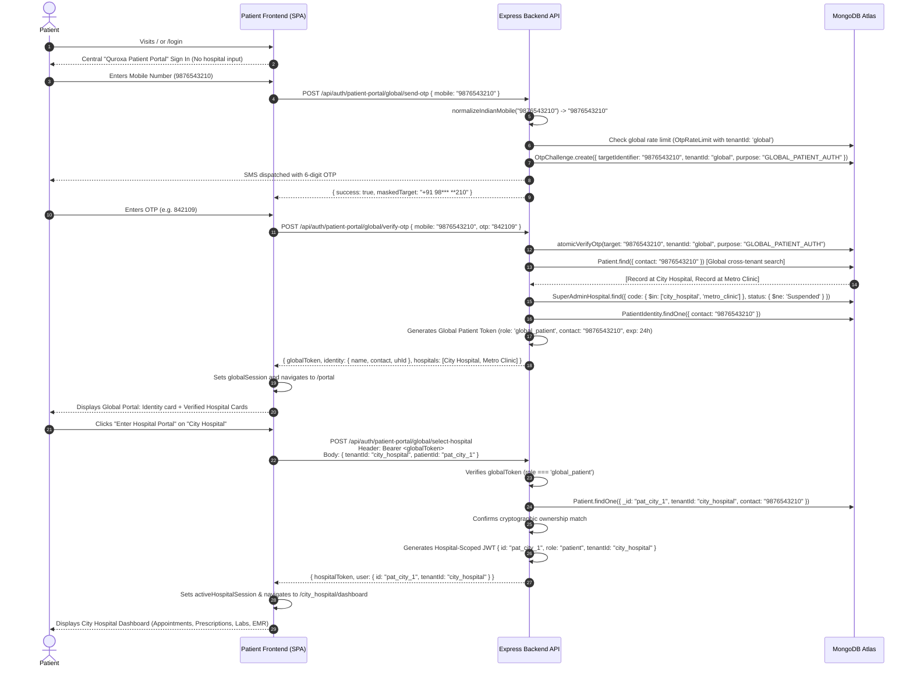
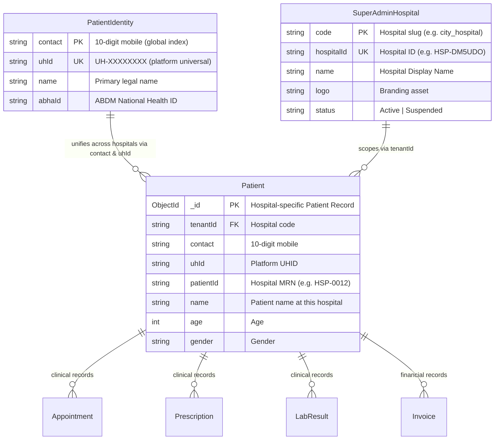

# QUROXA — PATIENT PORTAL
## GLOBAL AUTHENTICATION & HOSPITAL SELECTION FLOW REDESIGN ARCHITECTURAL PROPOSAL

**Document Version:** 1.0.0  
**Status:** PROPOSED (Architecture Audit & Implementation Specification)  
**Author:** Antigravity Engineering & Architecture Team  
**Scope:** QUROXA Patient Frontend & Shared Healthcare Ecosystem  
**Authorization Gate:** Architecture Review ONLY — No code or production changes authorized.

---

## 1. CURRENT ARCHITECTURE

The current QUROXA platform operates under a multi-tenant healthcare model comprising three primary components:

```
┌─────────────────────────────────┐       ┌─────────────────────────────────┐
│     Existing Staff Frontend     │       │   Independent Patient Frontend  │
│  (https://curoxa-1.onrender.com)│       │(quroxa-patient-frontend.onrender)
└────────────────┬────────────────┘       └────────────────┬────────────────┘
                 │                                         │
                 │   HTTPS REST & WebSockets               │   HTTPS REST & WebSockets
                 │   (Strict Production CORS)              │   (Strict Production CORS)
                 ▼                                         ▼
         ┌─────────────────────────────────────────────────────────┐
         │                  Shared QUROXA Backend                  │
         │             (https://curoxa.onrender.com)               │
         └────────────────────────────┬────────────────────────────┘
                                      │
                                      ▼
                         ┌─────────────────────────┐
                         │   Shared MongoDB Atlas  │
                         │   (Multi-Tenant Schema) │
                         └─────────────────────────┘
```

### Current Frontend Routing Structure
- Root route (`/`): Renders `HospitalSelectPage` within `PatientLayout`.
- Prompt: Prompts the patient with *"Find Your Hospital"* and asks for a `hospitalId` or slug (e.g., `city_hospital`, `HSP-DM5UDO`).
- Redirection: On entering a slug, the client navigates to `/:hospitalSlug/login`.
- Login (`/:hospitalSlug/login`): Renders hospital branding and requests a 10-digit mobile number for that hospital.
- Protected Routes (`/:hospitalSlug/dashboard`, `/:hospitalSlug/appointments`, etc.): All routes require the URL slug and are guarded by hospital-scoped session tokens.

### Current Architectural Defect
Requiring patients to identify and supply a hospital slug before authenticating creates friction:
1. Patients frequently do not know their clinic's technical database slug or hospital ID.
2. A patient registered at multiple clinics (e.g., City Hospital for cardiology, Metro Clinic for dental) cannot see their consolidated healthcare network.
3. Accessing a second hospital requires full logout, manual URL alteration, and a redundant SMS OTP verification.

---

## 2. CURRENT AUTHENTICATION FLOW

The existing authentication sequence is tenant-coupled from step one:



### Critical Flaws in Current Flow
- **Tenant Context Required Upfront**: `send-otp` strictly validates `if (!rawTenantId) return res.status(400)`.
- **OTP Challenge Keyed by Tenant**: `hashOtp(code, identifier, tenantId, purpose)` binds the hash to the tenant.
- **Isolated Query Scope**: `verify-otp` only looks up `Patient` records inside the single provided `tenantId`. Other hospitals are completely invisible.

---

## 3. PROPOSED GLOBAL AUTHENTICATION FLOW

The redesigned patient journey introduces a central, global identity verification step, followed by server-side hospital discovery and secure profile selection:



---

## 4. PROPOSED ROUTE STRUCTURE

The patient frontend routes are reorganized into three distinct functional tiers:

```
quroxa-patient-frontend
│
├── Public Auth Routes (Global & Unauthenticated)
│   ├── /                      → GlobalLoginPage (Central Patient Sign In)
│   ├── /login                 → GlobalLoginPage (Alias)
│   └── /privacy               → PrivacyPolicyPage (Platform-wide DPDP disclosure)
│
├── Authenticated Global Portal (Central Hub)
│   └── /portal                → GlobalPortalPage (Protected by GlobalRouteGuard)
│                                  ├── Patient Identity Card (Global UHID, Name, Contact)
│                                  ├── Associated Hospitals Grid (Branding, Code, Profiles)
│                                  ├── Dependent / Multi-profile selector per clinic
│                                  └── New Hospital Onboarding / Registration link
│
├── Hospital-Scoped Clinical Portal (Stage D Modules - Scoped to Selected Hospital)
│   └── /:hospitalSlug         → PortalBrandingProvider + HospitalRouteGuard
│       ├── /                  → Redirect to /:hospitalSlug/dashboard
│       ├── /dashboard         → OverviewPage (Clinical Summary)
│       ├── /appointments      → AppointmentsPage
│       ├── /appointments/book → BookAppointmentPage
│       ├── /prescriptions     → PrescriptionsPage (with verified Letterhead)
│       ├── /lab-results       → LabResultsPage
│       ├── /medical-records   → MedicalRecordsPage (EMR & Visit Timeline)
│       ├── /billing           → BillingPage (Read-Only Financial Summary)
│       ├── /profile           → ProfilePage
│       └── /privacy           → PrivacyConsentPage (Tenant DPDP Preferences)
│
└── Backward Compatibility Routes
    └── /:hospitalSlug/login   → Preserved redirect: Guides patient into global flow
```

---

## 5. REQUIRED API ENDPOINTS

To support the global flow without modifying staff routes or breaking existing patient routes, three clean API endpoints are specified:

### 5.1 POST `/api/auth/patient-portal/global/send-otp`
- **Purpose**: Dispatches OTP challenge to patient's mobile without requiring hospital context.
- **Access**: Public / Rate-limited (`authLimiter`).
- **Request Body**:
  ```json
  {
    "mobile": "9876543210"
  }
  ```
- **Validation**:
  - `mobile` normalized via `normalizeIndianMobile()`.
  - Rate limiting enforced via `OtpRateLimit` with `tenantId: 'global'` and `purpose: 'GLOBAL_PATIENT_AUTH'`.
- **Response (`200 OK`)**:
  ```json
  {
    "success": true,
    "channel": "sms",
    "maskedTarget": "+91 98*** **210",
    "message": "A 6-digit verification code has been dispatched via SMS to +91 98*** **210."
  }
  ```

### 5.2 POST `/api/auth/patient-portal/global/verify-otp`
- **Purpose**: Atomically verifies the global OTP and resolves all hospital associations.
- **Access**: Public / Rate-limited.
- **Request Body**:
  ```json
  {
    "mobile": "9876543210",
    "otp": "842109"
  }
  ```
- **Execution Logic**:
  1. Calls `atomicVerifyOtp({ targetIdentifier: normalizedMobile, tenantId: 'global', purpose: 'GLOBAL_PATIENT_AUTH', otpCandidate: otp })`.
  2. Queries `Patient.find({ contact: normalizedMobile }).lean()`.
  3. If matching patients found:
     - Extracts unique tenant IDs: `const tenantIds = [...new Set(matchingPatients.map(p => p.tenantId))]`.
     - Queries active hospitals: `SuperAdminHospital.find({ code: { $in: tenantIds }, status: { $ne: 'Suspended' } })`.
     - Resolves global identity from `PatientIdentity.findOne({ contact: normalizedMobile })`.
     - Signs **Global Patient Token**:
       ```javascript
       jwt.sign({
         role: 'global_patient',
         contact: normalizedMobile,
         uhId: patientIdentity?.uhId || matchingPatients[0]?.uhId || '',
         name: patientIdentity?.name || matchingPatients[0]?.name || 'Patient'
       }, getJwtSecret(), { expiresIn: '24h' });
       ```
     - Returns grouped hospital list.
  4. If no matching patients found (`matchingPatients.length === 0`):
     - Issues short-lived registration token (`isNewUser: true`).
- **Response (`200 OK`)**:
  ```json
  {
    "status": "success",
    "globalToken": "eyJhbGciOi...",
    "identity": {
      "name": "Ramesh Sharma",
      "contact": "9876543210",
      "uhId": "UH-8F42K7D1"
    },
    "hospitals": [
      {
        "tenantId": "city_hospital",
        "hospitalId": "HSP-DM5UDO",
        "name": "City Hospital",
        "logo": "C",
        "status": "Active",
        "profiles": [
          {
            "id": "67375a1...",
            "patientId": "HSP-0012",
            "name": "Ramesh Sharma",
            "uhId": "UH-8F42K7D1",
            "age": 45,
            "gender": "Male"
          },
          {
            "id": "67375b2...",
            "patientId": "HSP-0013",
            "name": "Aarav Sharma",
            "uhId": "UH-9B21C4F2",
            "age": 8,
            "gender": "Male"
          }
        ]
      },
      {
        "tenantId": "metro_clinic",
        "hospitalId": "HSP-METRO1",
        "name": "Metro Clinic",
        "logo": "M",
        "status": "Active",
        "profiles": [
          {
            "id": "67381e4...",
            "patientId": "MET-0442",
            "name": "Ramesh Sharma",
            "uhId": "UH-8F42K7D1",
            "age": 45,
            "gender": "Male"
          }
        ]
      }
    ],
    "isNewUser": false
  }
  ```

### 5.3 POST `/api/auth/patient-portal/global/select-hospital`
- **Purpose**: Exchanges a verified global token for a hospital-scoped patient access token.
- **Access**: Authenticated via `Authorization: Bearer <globalToken>`.
- **Request Body**:
  ```json
  {
    "tenantId": "city_hospital",
    "patientId": "67375a1..."
  }
  ```
- **Validation**:
  1. Decodes `globalToken` and verifies `role === 'global_patient'`.
  2. Queries `Patient.findOne({ _id: patientId, tenantId, contact: decoded.contact })`.
     *(Ensures patient record belongs to the requested hospital AND matches the authenticated phone).*
  3. Queries `SuperAdminHospital.findOne({ code: tenantId, status: { $ne: 'Suspended' } })`.
  4. Resolves or creates hospital-specific `User` account.
  5. Signs and returns standard hospital-scoped patient JWT.
- **Response (`200 OK`)**:
  ```json
  {
    "status": "success",
    "token": "eyJhbGciOi...",
    "user": {
      "id": "67375a1...",
      "role": "patient",
      "tenantId": "city_hospital",
      "name": "Ramesh Sharma",
      "uhId": "UH-8F42K7D1",
      "contact": "9876543210"
    },
    "hospital": {
      "tenantId": "city_hospital",
      "hospitalId": "HSP-DM5UDO",
      "name": "City Hospital",
      "logo": "C"
    }
  }
  ```

---

## 6. GLOBAL IDENTITY-TO-HOSPITAL MAPPING

### Existing Data Model Reality
The backend database audit confirms that the existing data model **already supports** mapping a single global patient to multiple hospitals:



### Identity Integrity Invariants
1. **`req.user.id` Rule**: In all clinical queries (Appointments, Prescriptions, Labs, EMR, Billing), `req.user.id` represents `Patient._id`. This proposal strictly preserves this mapping in Step 3 when generating the hospital-scoped token.
2. **UHID Consistency**: A patient visiting three hospitals receives the exact same `uhId` (e.g. `UH-8F42K7D1`) across all three hospitals via `identifierEngine.js`.
3. **No Phantom Records**: No mock or temporary `Patient` records are auto-created. Only actual patient records registered by hospital reception or verified self-registration appear in the portal.

---

## 7. JWT & SESSION ARCHITECTURE

A two-tier token hierarchy is established to prevent privilege escalation while enabling seamless navigation:

```
┌────────────────────────────────────────────────────────────────────────┐
│                        TIER 1: GLOBAL TOKEN                            │
│                        (Issued at /login)                              │
├────────────────────────────────────────────────────────────────────────┤
│ Claims:                                                                │
│   role: "global_patient"                                               │
│   contact: "9876543210"                                                │
│   uhId: "UH-8F42K7D1"                                                  │
│   name: "Ramesh Sharma"                                                │
│   exp: now + 24 hours                                                  │
├────────────────────────────────────────────────────────────────────────┤
│ Permissions:                                                           │
│   ✓ View /portal hospital list                                         │
│   ✓ Exchange for hospital-scoped access token                          │
│   ✗ CANNOT access any clinical APIs (Appointments, Rx, Labs, Billing)  │
│   ✗ CANNOT join tenant Socket.IO rooms                                 │
└───────────────────────────────────┬────────────────────────────────────┘
                                    │
                                    │ POST /select-hospital
                                    │ (Cryptographically Validated)
                                    ▼
┌────────────────────────────────────────────────────────────────────────┐
│                       TIER 2: HOSPITAL TOKEN                           │
│                     (Issued on hospital entry)                         │
├────────────────────────────────────────────────────────────────────────┤
│ Claims:                                                                │
│   id: "67375a1..." (Patient._id -> req.user.id)                        │
│   userId: "6737599..." (User._id)                                      │
│   role: "patient"                                                      │
│   tenantId: "city_hospital"                                            │
│   uhId: "UH-8F42K7D1"                                                  │
│   staff_id: "9876543210"                                               │
│   exp: now + 24 hours                                                  │
├────────────────────────────────────────────────────────────────────────┤
│ Permissions:                                                           │
│   ✓ Authorizes all Stage D clinical routes for "city_hospital"         │
│   ✓ Joins Socket.IO room `tenant:city_hospital:patient`                │
│   ✗ CANNOT access data of any other hospital                           │
└────────────────────────────────────────────────────────────────────────┘
```

---

## 8. MULTIPLE HOSPITAL SCENARIOS

The proposal addresses all five specified operational scenarios:

### Scenario A: Patient Registered at One Hospital
- Patient logs in globally.
- `/portal` displays a single hospital card.
- User clicks "Enter Hospital Portal" (or optionally auto-redirects on first login).
- Enters `/:hospitalSlug/dashboard`.

### Scenario B: Patient Registered at Three Hospitals
- Patient logs in globally.
- `/portal` displays all three verified hospital cards:
  - City Hospital (`city_hospital`)
  - Metro Clinic (`metro_clinic`)
  - Apollo Delhi (`apollo_delhi`)
- The patient selects any hospital to access its records.
- In the navigation bar, a persistent *"All Hospitals"* button allows switching to another clinic instantly without an OTP challenge.

### Scenario C: Multiple Profiles Under One Mobile Number (Dependents)
- At City Hospital, Ramesh has his own profile (`Ramesh Sharma`, Age 45) and his son's profile (`Aarav Sharma`, Age 8).
- Under the "City Hospital" card, both profiles are listed with their respective name, age, gender, and UHID.
- The user selects which profile to open. The issued hospital token embeds that specific profile's `Patient._id`.

### Scenario D: Patient Attempts Access to Unregistered Hospital
- If a patient types `/unknown_clinic/dashboard` directly:
  1. The client checks if the active hospital token matches `unknown_clinic`.
  2. If not, it attempts an exchange using `globalToken`.
  3. The backend checks `Patient.findOne({ tenantId: 'unknown_clinic', contact: authenticatedPhone })`.
  4. Finding no record, the backend returns `403 Forbidden: You do not have an active patient record at this hospital.`
  5. Client displays a clear error state with an option to return to `/portal`.

### Scenario E: URL Manipulation & Tenant Spoofing
- If a patient authenticated at City Hospital changes the browser URL to `/apollo_delhi/appointments`:
  1. Client-Side: `ProtectedRoute` detects `sessionTenant ('city_hospital') !== urlSlug ('apollo_delhi')` and halts execution.
  2. Server-Side: Even if a malicious request reached the backend with `Authorization: Bearer <city_hospital_token>`, backend middleware enforces `req.tenantId = decoded.tenantId`. The query will execute against `city_hospital`, rendering cross-tenant data leakage impossible.

---

## 9. TENANT ISOLATION STRATEGY

Tenant isolation is preserved across all architectural layers:

1. **Database Layer**: All clinical documents (`Prescription`, `Appointment`, `LabResult`, `Visit`, `Billing`) contain mandatory, indexed `tenantId` fields.
2. **Backend Query Enforcement**: Clinical route handlers do not accept `tenantId` from client query strings; `req.tenantId` is strictly bound to the verified JWT payload.
3. **Socket.IO Room Isolation**: Patient sockets strictly join `tenant:<tenantId>:patient` and `user:<userId>`. Staff operational rooms (`<tenantId>`) remain unreachable.
4. **Global Token Isolation**: The global token has role `global_patient`. All clinical routes require `role: 'patient'`, ensuring global tokens cannot be used to read clinical records.

---

## 10. EXISTING FUNCTIONALITY AFFECTED

| Component | Status | Impact / Changes Required |
|---|---|---|
| **Patient Registration** | **PRESERVED** | New patients can still register via `POST /api/patients` using `tempToken`. When a patient registers at a new hospital, that hospital immediately appears in their `/portal` on their next visit. |
| **OTP Rate Limiting** | **PRESERVED** | Central rate limiter (`OtpRateLimit`) maintains 5 requests / 10 min window and 30s cooldown for global challenges. |
| **Socket.IO Isolation** | **PRESERVED** | Socket connections initialize only when a hospital session is active, using the hospital-scoped token. |
| **Staff Frontend** | **UNTOUCHED** | Zero changes to `curoxa-1.onrender.com` or staff auth routes. |
| **Legacy Patient Portal** | **UNTOUCHED** | `/patient/login` on the staff frontend remains operational. |
| **Clinical Modules** | **PRESERVED** | Appointments, Prescriptions, Labs, EMR, Billing, and Profile modules in `quroxa-patient-frontend` require zero internal modifications; they continue consuming `api` with the hospital token. |

---

## 11. BACKEND CHANGES REQUIRED

All backend changes are additive and contained within `clinical_management/backend/routes/authRoutes.js` (or a dedicated `patientPortalRoutes.js`):

1. **Add `GLOBAL_PATIENT_AUTH` to OtpChallenge Schema**:
   Update `models/OtpChallenge.js` enum:
   ```javascript
   purpose: {
     type: String,
     enum: [
       'STAFF_LOGIN',
       'PATIENT_PORTAL_AUTH',
       'GLOBAL_PATIENT_AUTH', // <-- ADDED
       'FORGOT_PASSWORD',
       ...
     ]
   }
   ```
2. **Implement `POST /api/auth/patient-portal/global/send-otp`**:
   Dispatches SMS OTP without requiring `tenantId`, using `tenantId: 'global'`.
3. **Implement `POST /api/auth/patient-portal/global/verify-otp`**:
   Verifies global challenge and aggregates patient profiles across all active hospitals.
4. **Implement `POST /api/auth/patient-portal/global/select-hospital`**:
   Validates ownership and issues the hospital-scoped JWT.

---

## 12. FRONTEND CHANGES REQUIRED

All frontend changes are contained within `quroxa-patient-frontend`:

1. **New Page: `GlobalLoginPage.jsx` (`src/pages/auth/GlobalLoginPage.jsx`)**:
   - Central Quroxa Patient Portal branding.
   - Mobile number input (`+91`).
   - 6-digit OTP challenge inputs.
   - Zero hospital selection.
2. **New Page: `GlobalPortalPage.jsx` (`src/pages/portal/GlobalPortalPage.jsx`)**:
   - Global Patient Identity card (Name, Phone, Universal UHID).
   - Responsive grid of associated hospitals with branding, address, and profile badges.
   - One-click "Enter Hospital" button and dependent selector.
3. **Auth Context Enhancement (`src/context/AuthContext.jsx`)**:
   - Manage `globalSession` (`globalToken`, `identity`, `hospitals`) in `sessionStorage` / state.
   - Manage `hospitalSession` (`token`, `user`, `activeHospital`) for clinical routes.
   - Provide `selectHospital(tenantId, patientId)` action.
   - Provide `switchHospital()` action returning to `/portal`.
4. **Router Update (`src/app/router.jsx`)**:
   - Route `/` and `/login` -> `GlobalLoginPage`.
   - Route `/portal` -> `GlobalPortalPage`.
   - Route `/:hospitalSlug/*` -> Hospital clinical dashboard with `HospitalRouteGuard`.
5. **Auth Service Enhancement (`src/services/authService.js`)**:
   - Add `sendGlobalOtp`, `verifyGlobalOtp`, `selectHospitalSession`.

---

## 13. MIGRATION & BACKWARD-COMPATIBILITY STRATEGY

1. **Preserve Existing Endpoints**:
   Existing endpoints (`/api/auth/patient-portal/send-otp` and `/verify-otp`) remain fully functional.
2. **Direct Hospital Link Handling**:
   If a patient navigates directly to `/:hospitalSlug/login` (e.g. from an appointment reminder SMS), the page can either:
   - Allow login directly for that hospital (legacy behavior), OR
   - Redirect to `/login?redirectHospital=:hospitalSlug`, logging in globally and auto-selecting that hospital post-verification.
3. **Zero Database Migrations Required**:
   Because `Patient.contact` and `PatientIdentity.contact` already exist and link records across tenants, zero schema migrations or data backfills are necessary.

---

## 14. SECURITY TEST PLAN

| Test ID | Test Scenario | Expected Outcome |
|---|---|---|
| **SEC-GLB-01** | Global Send OTP with valid 10-digit Indian mobile | Dispatches OTP; records challenge under `tenantId: 'global'`; returns 200 OK. |
| **SEC-GLB-02** | Global Send OTP rate limiting (6 requests in 5 minutes) | 6th request blocked with `429 Too Many Requests`. |
| **SEC-GLB-03** | Global OTP verification with wrong code | Returns `400 Invalid verification code`; increments attempt counter. |
| **SEC-GLB-04** | Global OTP verification brute force lockout (5 failed attempts) | Challenge locked for 15 minutes with `429 Account Locked`. |
| **SEC-GLB-05** | Global OTP single-use replay attempt | Replay blocked with `400 Verification code has already been used`. |
| **SEC-GLB-06** | Cross-tenant patient aggregation check | Returns strictly hospitals where the mobile number is registered; omits unrelated hospitals. |
| **SEC-GLB-07** | Profile enumeration prevention | Unauthenticated queries cannot inspect hospital associations. |
| **SEC-GLB-08** | Unauthorized hospital selection (patientId not belonging to phone) | Exchange endpoint returns `403 Forbidden`. |
| **SEC-GLB-09** | Suspended hospital access attempt | Exchange endpoint returns `403 Hospital account is suspended`. |
| **SEC-GLB-10** | Global Token clinical API rejection | Attempting to call `/api/prescriptions` with `globalToken` returns `401 Unauthorized` / `403 Forbidden`. |
| **SEC-GLB-11** | Cross-hospital URL tampering in browser | URL slug mismatch is trapped by `ProtectedRoute`; client redirects to safe state. |

---

## 15. PRODUCTION DEPLOYMENT PLAN

When authorized, the rollout will execute in four controlled phases:

1. **Phase 1: Backend API Additions (Non-Breaking)**:
   - Add `GLOBAL_PATIENT_AUTH` enum value in `OtpChallenge.js`.
   - Add `send-otp`, `verify-otp`, and `select-hospital` endpoints to `authRoutes.js`.
   - Run automated test suite (`verify_global_patient_auth.js`) against local/staging backend.
   - Commit, push, and deploy backend to Render (`srv-da9t6nss728c73eooctg`).
2. **Phase 2: Frontend Implementation**:
   - Implement `GlobalLoginPage` and `GlobalPortalPage` in `quroxa-patient-frontend`.
   - Update `AuthContext` and router.
   - Test locally across mobile and desktop viewports.
3. **Phase 3: Frontend Deployment & Verification**:
   - Commit and push `quroxa-patient-frontend` to GitHub `main`.
   - Render automatically builds and deploys Static Site.
   - Verify live on `https://quroxa-patient-frontend.onrender.com`.
4. **Phase 4: Post-Deployment Smoke Testing**:
   - Verify single-hospital and multi-hospital patient journeys.
   - Verify staff frontend regression (ensure staff login is 100% operational).

---

## 16. CONCLUSION & RECOMMENDATION

The proposed architecture resolves the user-journey defect cleanly:
- Hospital selection is eliminated from the entry screen.
- Authentication is unified and mobile-first.
- The patient receives a centralized portal (`/portal`) displaying all their verified healthcare providers.
- Clinical data remains strictly scoped and protected by the existing `req.user.id = Patient._id` architecture.
- Zero changes to the staff application or database schemas are required.

**Status: Stopped and awaiting operator review and authorization before proceeding.**
