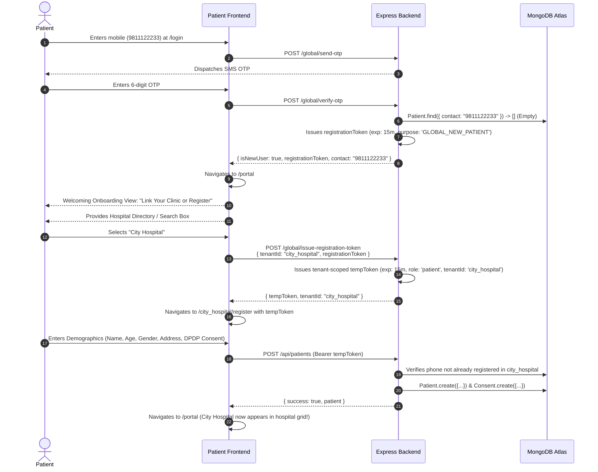
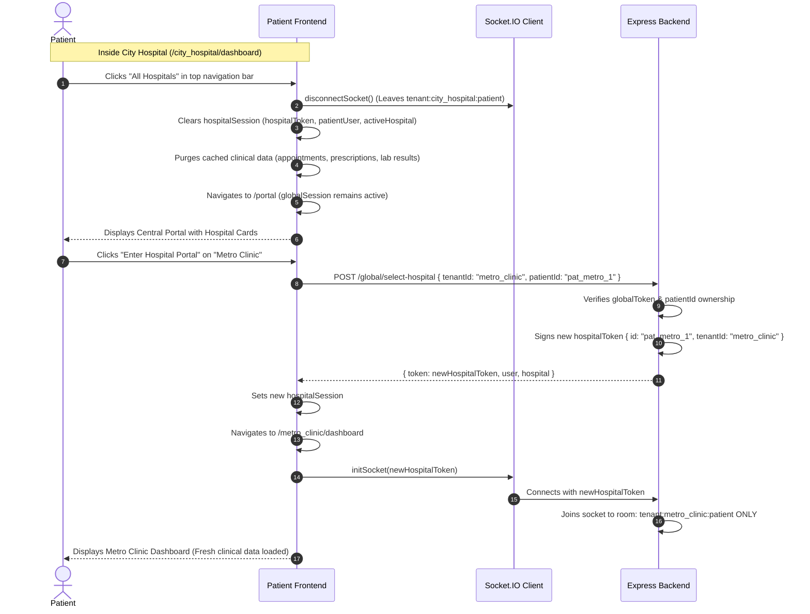

# QUROXA — GLOBAL PATIENT PORTAL
## ARCHITECTURAL REVISION 1.1 — IDENTITY, DEPENDENT ACCESS & SECURITY SPECIFICATION

**Document Version:** 1.1.0  
**Status:** PROPOSED (Revision 1.1 Architecture Specification)  
**Author:** Antigravity Engineering & Architecture Team  
**Scope:** QUROXA Patient Frontend & Shared Healthcare Ecosystem  
**Authorization Gate:** READ-ONLY ARCHITECTURAL REVIEW — Implementation is NOT authorized.

---

## 1. VERIFIED DATABASE RELATIONSHIP MODEL

A comprehensive audit of the production MongoDB schemas, models, and controllers was conducted across `clinical_management/backend/models/`.

### 1.1 Actual Source Entity Definitions

```mermaid
classDiagram
    class PatientIdentity {
        +ObjectId _id
        +String uhId "UK: UH-XXXXXXXX"
        +String contact "UK (Index): 10-digit mobile"
        +String name "Full Name"
        +String email "Optional"
        +String abhaId "ABDM National ID"
        +Date createdAt
        +Date updatedAt
    }

    class Patient {
        +ObjectId _id "PK: Clinical Reference"
        +String tenantId "Indexed Hospital Code"
        +String contact "10-digit mobile"
        +String uhId "Platform UHID"
        +String patientId "Hospital MRN (e.g. PAT-HSP01-000001)"
        +String name "Patient Full Name"
        +Number age "Age in years"
        +String gender "Male | Female | Other"
        +String dob "Date of Birth"
        +Object emergencyContact "{ name, relation, phone }"
        +Boolean legalHold
        +Date createdAt
    }

    class SuperAdminHospital {
        +ObjectId _id
        +String code "UK: e.g. city_hospital"
        +String hospitalId "UK: HSP-XXXXXX"
        +String name "Display Name"
        +String logo "Branding Asset"
        +String status "Canonical: Active | Suspended | Inactive"
        +String subscriptionStatus "ACTIVE | EXPIRING | EXPIRED | SUSPENDED"
        +Object modules "{ reception, doctor, pharmacy, labs, dpdp }"
    }

    class User {
        +ObjectId _id
        +String tenantId "Hospital Code"
        +String staff_id "Contact / Username"
        +String role "patient | doctor | admin | staff"
        +String phone "Mobile Number"
        +Boolean isSetupComplete
    }

    class OtpChallenge {
        +ObjectId _id
        +String targetIdentifier "Normalized Mobile / Email"
        +String identifierType "phone | email"
        +String tenantId "Explicit Hospital or 'global'"
        +String purpose "Enum of authorized security purposes"
        +String hashedOtp "HMAC-SHA256 hex string"
        +Number attempts "0..5 brute-force counter"
        +Date lockUntil "15m Lockout timestamp"
        +Date expiresAt "TTL expiration"
        +Date consumedAt "Single-use timestamp"
    }

    class ProfileSelectionToken {
        +ObjectId _id
        +String jti "UK: Token UUID"
        +String tenantId "Hospital Code"
        +String contact "Mobile Number"
        +Array allowedPatientIds "Array of Patient._id"
        +Date consumedAt "Single-use timestamp"
        +Date expiresAt "TTL expiration"
    }

    PatientIdentity "1" .. "0..*" Patient : "resolves UHID via contact"
    SuperAdminHospital "1" -- "0..*" Patient : "scopes clinical boundary"
    Patient "1" -- "0..*" User : "authenticates portal session"
```

### 1.2 Entity Relationship Analysis

| Relationship Pair | Cardinality | Implementation Reality & Constraints |
|---|---|---|
| **`PatientIdentity.contact` ↔ `PatientIdentity.uhId`** | **1 : 1 (Strict)** | `PatientIdentity` enforces `{ contact: 1, unique: true }` and `{ uhId: 1, unique: true }`. One mobile number maps to exactly ONE universal UHID at the `PatientIdentity` level. |
| **`PatientIdentity.contact` ↔ `Patient.contact`** | **1 : N** | Multiple `Patient` records across different hospitals (`tenantId`) and even within the same hospital share the exact same `contact` phone number. |
| **`PatientIdentity.uhId` ↔ `Patient.uhId`** | **1 : N (Shared)** | When `resolveOrCreateUhid({ contact })` is called, it reuses the single `uhId` found for that `contact`. Consequently, multiple family members registered under one phone number currently receive the **same** `uhId` unless explicitly overridden. |
| **`Patient._id` ↔ Clinical Records** | **1 : N (Foreign Key)** | `Prescription.patientId`, `Appointment.patientId`, `LabResult.patientId`, `Visit.patientId`, and `Billing.patientId` store `Patient._id`. **Crucial Invariant:** `req.user.id` MUST ALWAYS be `Patient._id`, never `User._id`. |
| **`Patient` ↔ Guardian / Dependent** | **0 : 0 (Missing)** | **No schema relationship exists.** `Patient.js` has no `guardianId`, `primaryPatientId`, `isDependent`, or family-link field. The only existing link between family members is coincidentally matching strings in `Patient.contact`. |

---

## 2. RESOLVING THE DEPENDENT IDENTITY CONFLICT

### 2.1 Answers to Core Architectural Questions

#### 1. Can one mobile number legitimately be linked to multiple individual patient identities?
**YES.** In Indian healthcare and ABDM standards, pediatric dependents (children, infants) and elderly family members frequently do not possess personal mobile phones. Up to 5–6 family members legitimately share a single mobile number for clinical appointments and OTP delivery.

#### 2. Does `PatientIdentity` represent a person or a mobile number?
**In the current schema, `PatientIdentity` represents a MOBILE NUMBER, NOT a person.**  
Because `contact` is marked `{ unique: true }`, MongoDB Atlas forbids creating a second `PatientIdentity` document for another person sharing that phone number. Whoever was registered first (e.g. parent) occupies the `PatientIdentity` record.

#### 3. How are dependents linked to guardians?
**Currently, they are NOT linked.**  
The database contains no foreign keys, relational arrays, or linkage collections connecting a dependent's `Patient` record to a guardian's `Patient` record. The system currently groups records solely by string equality: `Patient.find({ contact: mobile })`.

#### 4. Can the system distinguish a parent from a child?
**Only heuristically via `Patient.age` or `Patient.dob`.**  
There is no explicit boolean (`isDependent`), legal guardian reference, or role hierarchy in the database schema.

#### 5. How is authorization for accessing a dependent's medical records established?
**Solely via possession of the SMS OTP sent to the shared mobile number.**  
In Stage C, `authRoutes.js` issues a `ProfileSelectionToken` containing all `Patient._id`s that share the mobile number. The person holding the phone can select any profile without verifiable guardian consent or legal relationship tracking.

#### 6. Does the existing database already preserve these relationships?
**NO.** The claim in V1.0 that *"zero database migrations are required"* was inaccurate. While the system can discover records sharing a phone number, it cannot verify guardian authorization, distinguish account holders from dependents, or assign separate global UHIDs to dependents without schema modifications.

---

## 3. DEPENDENT & GUARDIAN ACCESS MODEL

To comply with the **Digital Personal Data Protection (DPDP) Act 2023 (Section 9: Processing of personal data of children)** and prevent unauthorized access:

### 3.1 Identity Separation: Account Holder vs Dependent Profiles
We establish an explicit architectural distinction:
1. **Primary Account Holder (Guardian)**: The adult individual who owns and operates the registered mobile number. Holds the primary global session.
2. **Dependent Profiles**: Minors or family members whose clinical care is managed by the Account Holder.

### 3.2 Required Schema Enhancements (Non-Breaking Additions)

#### A. Enhancements to `Patient.js` (`models/Patient.js`)
Add three additive fields to the existing `patientSchema`:
```javascript
// Guardian / Dependent Relationship Fields (DPDP Act 2023 Compliant)
isDependent: { 
  type: Boolean, 
  default: false, 
  index: true 
},
relationshipToPrimary: { 
  type: String, 
  enum: ['self', 'child', 'spouse', 'parent', 'ward', 'other'], 
  default: 'self' 
},
guardianConsent: {
  consentGranted: { type: Boolean, default: false },
  consentDate: { type: Date },
  guardianName: { type: String, default: '' },
  verifiableConsentSignature: { type: String, default: '' }
}
```

#### B. Enhancements to `PatientIdentity.js` (`models/PatientIdentity.js`)
To allow dependents sharing a phone number to hold distinct, valid platform UHIDs:
- Maintain `contact` as indexed, but **remove `{ unique: true }` constraint on `contact`**; replace with compound index `{ contact: 1, uhId: 1 }` (unique) OR define `PatientIdentity` as the primary account record with an embedded `dependents` subdocument array:
```javascript
// Additive subdocument on PatientIdentity for dependents under the same phone
dependents: [{
  uhId: { type: String, required: true },
  name: { type: String, required: true },
  dob: { type: String, default: '' },
  gender: { type: String, enum: ['Male', 'Female', 'Other'] },
  relationship: { type: String, enum: ['child', 'spouse', 'parent', 'ward', 'other'] },
  registeredAtTenantId: { type: String }
}]
```

### 3.3 Access Control & Minor Protection Policy
- **Adult Dependents (Age ≥ 18)**: If a profile is an adult (e.g. spouse, elderly parent), the portal must display a DPDP consent notice: *"You are accessing clinical records for an adult family member. Explicit authorization is required under the DPDP Act 2023."*
- **Child Dependents (Age < 18)**: The Account Holder acts as the legal guardian. First access requires a digital guardian consent acknowledgement.

---

## 4. PATIENT PROFILE DISCOVERY ARCHITECTURE

### 4.1 Vulnerability of Naive Query (`Patient.find({ contact })`)
Querying `Patient.find({ contact: normalizedMobile })` globally presents two privacy and security risks:
1. **Data Leakage via Recycled Phone Numbers**: In India, telecom operators recycle mobile numbers after 90 days of inactivity. A new phone owner could discover previous owners' hospital profiles if records are linked purely by phone number string.
2. **Over-Exposure of Demographics**: Returning full patient documents (MRN, age, gender, address, UHID) in the initial global discovery response violates data minimization principles.

### 4.2 Data-Minimizing Discovery Contract
Global discovery returns **only minimal, obfuscated metadata** necessary for hospital and profile identification:

```json
{
  "hospitals": [
    {
      "tenantId": "city_hospital",
      "hospitalId": "HSP-DM5UDO",
      "name": "City Hospital",
      "logo": "C",
      "address": "Civil Lines, New Delhi",
      "profiles": [
        {
          "profileId": "67375a1...",
          "maskedName": "Ramesh S. (Self)",
          "relationship": "self",
          "isDependent": false
        },
        {
          "profileId": "67375b2...",
          "maskedName": "Aarav S. (Child)",
          "relationship": "child",
          "isDependent": true
        }
      ]
    }
  ]
}
```

*Sensitive clinical data (full UHID, hospital MRN, exact age, DOB, blood group, address) is NEVER returned in the discovery payload. It is only released after explicit profile selection.*

### 4.3 Preservation of Stage C Single-Use Profile Selection Tokens
If a selected hospital has multiple profiles under the phone number:
1. The backend issues a single-use `ProfileSelectionToken` bound to `{ tenantId, contact, allowedPatientIds, jti }`.
2. The client presents this single-use token along with the chosen `patientId`.
3. The backend consumes the token atomically in MongoDB (`consumedAt = new Date()`), preventing replay or concurrent profile hijacking.

---

## 5. GLOBAL TOKEN SECURITY MODEL

### 5.1 Token Classification & Claims

```
┌────────────────────────────────────────────────────────────────────────┐
│                   GLOBAL PATIENT SESSION TOKEN                         │
├────────────────────────────────────────────────────────────────────────┤
│ Header:                                                                │
│   typ: "JWT"                                                           │
│   alg: "HS256"                                                         │
│ Payload:                                                               │
│   iss: "quroxa-auth-engine"                                            │
│   aud: "quroxa-patient-portal-global"                                  │
│   sub: "9876543210" (Verified Indian Mobile)                           │
│   token_use: "global_portal"                                           │
│   role: "global_patient"                                               │
│   contact: "9876543210"                                                │
│   name: "Ramesh Sharma"                                                │
│   uhId: "UH-8F42K7D1"                                                  │
│   jti: "<uuid-v4>" (Unique Token ID for Revocation Tracking)           │
│   iat: <timestamp>                                                     │
│   exp: <timestamp + 60 minutes>                                        │
└────────────────────────────────────────────────────────────────────────┘
```

### 5.2 Strict Security Boundary Rules

| Threat / Channel | Defense Mechanism & Enforcement |
|---|---|
| **Clinical API Access Attempt** | All clinical endpoints (`/api/prescriptions`, `/api/appointments`, `/api/labs`, `/api/emr`, `/api/billing`) execute `verifyToken`. `verifyToken` requires `role === 'patient'` AND a non-empty `tenantId`. A `global_patient` token lacking `tenantId` is **immediately rejected with HTTP 403 Forbidden** (`code: 'GLOBAL_TOKEN_NOT_AUTHORIZED_FOR_CLINICAL'`). |
| **Socket.IO Real-Time Access** | `socketAuthMiddleware.js` verifies `decoded.tenantId`. A global token has no `tenantId` and is rejected at the WebSocket handshake: `Authentication error: Tenant identification missing from credentials`. |
| **Staff API Access Attempt** | Rejected by `verifyToken` and `isAdmin` (`Require Admin / Staff Role`). |
| **Token Lifespan & Blast Radius** | **Lifespan is strictly reduced from 24 hours to 60 minutes.** A compromised global token has an extremely narrow window of vulnerability. |
| **Session Invalidation on Logout** | Calling `logout()` discards the token from client memory and emits a revocation record (`RevokedSession.create({ jti, expiresAt })`), rendering the `jti` permanently invalid server-side. |

---

## 6. CANONICAL HOSPITAL STATUS & ASSOCIATION VALIDATION

### 6.1 Schema Reality (`models/SuperAdminHospital.js`)
Audit of `SuperAdminHospital.js` reveals two distinct status fields:
1. `status`: String (Default: `'Active'`). Can be `'Active'`, `'Suspended'`, `'Inactive'`, `'Pending'`, `'Onboarding'`.
2. `subscriptionStatus`: Enum `['ACTIVE', 'EXPIRING', 'EXPIRED', 'SUSPENDED']`.

### 6.2 Strict Production Eligibility Filter
Relying solely on `status: { $ne: 'Suspended' }` is **insecure** because it would inadvertently allow `'Pending'`, `'Onboarding'`, or `'EXPIRED'` hospitals to appear in the patient's portal.

The canonical, production-grade hospital query filter is:
```javascript
const hospitalFilter = {
  code: { $in: tenantIds },
  status: 'Active',
  subscriptionStatus: { $in: ['ACTIVE', 'EXPIRING'] }
};
```
*Hospitals with `status !== 'Active'` or `subscriptionStatus === 'EXPIRED'` or `'SUSPENDED'` are strictly filtered out and cannot be accessed.*

---

## 7. REVISED API CONTRACTS

### 7.1 POST `/api/auth/patient-portal/global/send-otp`
- **Rate Limit**: 5 requests / 10 minutes; 30-second cooldown per mobile.
- **Request**:
  ```json
  {
    "mobile": "9876543210"
  }
  ```
- **Validation**:
  - `mobile` validated against `^[6-9]\d{9}$`.
  - OtpChallenge created with `tenantId: 'global'` and `purpose: 'GLOBAL_PATIENT_AUTH'`.
- **Response (`200 OK`)**:
  ```json
  {
    "success": true,
    "channel": "sms",
    "maskedTarget": "+91 98*** **210"
  }
  ```

### 7.2 POST `/api/auth/patient-portal/global/verify-otp`
- **Request**:
  ```json
  {
    "mobile": "9876543210",
    "otp": "842109"
  }
  ```
- **Execution**:
  1. Atomically verify and consume OTP.
  2. Query `Patient.find({ contact: normalizedMobile }).select('_id tenantId name age gender uhId isDependent relationshipToPrimary')`.
  3. Query `SuperAdminHospital.find({ code: { $in: tenantIds }, status: 'Active', subscriptionStatus: { $in: ['ACTIVE', 'EXPIRING'] } })`.
  4. Query `PatientIdentity.findOne({ contact: normalizedMobile })`.
  5. Issue Global Patient Session Token (`exp: 60m`).
- **Response (`200 OK`)**:
  ```json
  {
    "status": "success",
    "globalToken": "eyJhbGciOi...",
    "identity": {
      "name": "Ramesh Sharma",
      "contact": "9876543210",
      "uhId": "UH-8F42K7D1"
    },
    "hospitals": [
      {
        "tenantId": "city_hospital",
        "hospitalId": "HSP-DM5UDO",
        "name": "City Hospital",
        "logo": "C",
        "profiles": [
          {
            "profileId": "67375a1...",
            "displayName": "Ramesh Sharma",
            "relationship": "self",
            "isDependent": false
          },
          {
            "profileId": "67375b2...",
            "displayName": "Aarav Sharma",
            "relationship": "child",
            "isDependent": true
          }
        ]
      }
    ],
    "isNewUser": false
  }
  ```

### 7.3 POST `/api/auth/patient-portal/global/select-hospital`
- **Authorization**: `Bearer <globalToken>`
- **Request**:
  ```json
  {
    "tenantId": "city_hospital",
    "patientId": "67375a1..."
  }
  ```
- **Execution**:
  1. Validate `globalToken` (`role === 'global_patient'`, not expired, not revoked).
  2. Verify ownership: `Patient.findOne({ _id: patientId, tenantId, contact: decoded.contact })`.
  3. Validate hospital status: `SuperAdminHospital.findOne({ code: tenantId, status: 'Active', subscriptionStatus: { $in: ['ACTIVE', 'EXPIRING'] } })`.
  4. Resolve or create hospital `User` account for patient role.
  5. Sign Hospital-Scoped Access Token:
     ```javascript
     jwt.sign({
       id: patientDoc._id,          // CRITICAL: req.user.id === Patient._id
       userId: user._id,
       role: 'patient',
       tenantId: patientDoc.tenantId,
       uhId: patientDoc.uhId,
       staff_id: patientDoc.contact,
       isDependent: patientDoc.isDependent || false,
       token_use: 'hospital_clinical'
     }, getJwtSecret(), { expiresIn: '12h' });
     ```
- **Response (`200 OK`)**:
  ```json
  {
    "status": "success",
    "token": "eyJhbGciOi...",
    "user": {
      "id": "67375a1...",
      "role": "patient",
      "tenantId": "city_hospital",
      "name": "Ramesh Sharma",
      "uhId": "UH-8F42K7D1"
    },
    "hospital": {
      "tenantId": "city_hospital",
      "name": "City Hospital",
      "logo": "C"
    }
  }
  ```

---

## 8. NEW PATIENT REGISTRATION FLOW

For a mobile number with zero existing patient records across all hospitals:



### Key Registration Safeguards
1. **No Phantom Records**: No empty or placeholder `Patient` records are created until the patient actually fills out the hospital registration form.
2. **Duplicate Prevention**: `POST /api/patients` executes its existing uniqueness check (`Patient.findOne({ tenantId, contact })`), preventing double registration at the same clinic.
3. **Hospital Rule Preservation**: Individual hospital registration fields, consent terms, and required forms are preserved.

---

## 9. MULTI-HOSPITAL SESSION SWITCHING SEQUENCE

When a patient moves between clinics in their network:



### Cache & Session Isolation Invariants
- `sessionStorage.hospitalToken` is cleared before navigation.
- React state stores (appointments, prescriptions, labs, billing) are reset to initial state.
- WebSocket rooms from the previous clinic are disconnected immediately.
- If a patient manually alters the URL to use `previousHospitalToken` at `newHospital`, the backend `req.tenantId` mismatch traps the call and returns `403 Forbidden`.

---

## 10. BACKWARD COMPATIBILITY & LEGACY ROUTE RESOLUTION

| Legacy Route / Mechanism | Behavior Under V1.1 Architecture | Backward Compatibility Guarantee |
|---|---|---|
| **`/:hospitalSlug/login` (Direct Bookmarked / SMS Link)** | Patient navigating directly to `/:hospitalSlug/login` is redirected to `/login?redirectHospital=:hospitalSlug`. | Prevents broken links from appointment reminder SMS messages. |
| **`redirectHospital` Parameter** | Validated against regex `/^[a-z0-9_-]{3,32}$/` and queried against `SuperAdminHospital.findOne({ code, status: 'Active' })`. | Eliminates open-redirect vulnerabilities. If the authenticated patient has a profile at that hospital, the portal auto-selects it; otherwise, it opens `/portal` with a clear explanation. |
| **Existing Backend Endpoints (`/patient-portal/send-otp`, `/verify-otp`)** | Completely preserved and functional. | Guarantees legacy staff frontend patient portal (`curoxa-1.onrender.com/patient/login`) never breaks. |
| **Staff Frontend (`curoxa-1.onrender.com`)** | Zero code modifications. | Unaffected and regression-free. |

---

## 11. REQUIRED DATABASE SCHEMA CHANGES & MIGRATION ASSESSMENT

To resolve the dependent identity conflict and support multi-profile healthcare under DPDP Act 2023, the following schema additions are required:

| Target Model | File Path | Required Modification | Migration Necessity |
|---|---|---|---|
| **`OtpChallenge.js`** | `models/OtpChallenge.js` | Add `'GLOBAL_PATIENT_AUTH'` to `purpose` enum array. | **Zero Migration** (Schema-level enum addition; backward compatible with existing records). |
| **`Patient.js`** | `models/Patient.js` | Add `isDependent`, `relationshipToPrimary`, and `guardianConsent` fields. | **Zero Migration** (Default values apply automatically to new queries; existing records default to `isDependent: false`). |
| **`PatientIdentity.js`** | `models/PatientIdentity.js` | Drop `{ unique: true }` constraint on `contact`; replace with compound index `{ contact: 1, uhId: 1 }` (unique). | **Controlled Migration Required**: MongoDB index rebuild (`db.patientidentities.dropIndex("contact_1")` followed by compound index creation) to allow dependents sharing a phone number to hold separate universal UHIDs. |

---

## 12. SECURITY TEST MATRIX (15 TEST SCENARIOS)

| Test ID | Security Scenario | Target Endpoint / Layer | Expected Outcome |
|---|---|---|---|
| **SEC-1.1-01** | Global OTP Send with valid mobile | `POST /global/send-otp` | 200 OK; challenge stored under `tenantId: 'global'`. |
| **SEC-1.1-02** | Global OTP Rate Limit (6 requests / 5m) | `POST /global/send-otp` | 6th request blocked with `429 Too Many Requests`. |
| **SEC-1.1-03** | Brute-force OTP lock (5 bad attempts) | `POST /global/verify-otp` | 5th bad attempt triggers 15-minute lockout (`429 Account Locked`). |
| **SEC-1.1-04** | Single-use OTP replay attempt | `POST /global/verify-otp` | 2nd submission rejected (`400 Verification code already consumed`). |
| **SEC-1.1-05** | Global token clinical API rejection | `GET /api/prescriptions` with `globalToken` | **403 Forbidden** (`Missing hospital context in token`). |
| **SEC-1.1-06** | Global token Socket.IO handshake rejection | WebSocket connection with `globalToken` | Connection rejected (`Handshake rejected: Missing tenantId`). |
| **SEC-1.1-07** | Profile enumeration prevention | Unauthenticated GET `/portal` | Redirects to `/login`; zero patient demographics leaked. |
| **SEC-1.1-08** | Unauthorized hospital profile selection | `POST /global/select-hospital` with non-owned `patientId` | **403 Forbidden** (`Requested profile not authorized`). |
| **SEC-1.1-09** | Suspended hospital selection attempt | `POST /global/select-hospital` for suspended clinic | **403 Forbidden** (`Hospital account is suspended`). |
| **SEC-1.1-10** | Inactive / Onboarding hospital exclusion | `POST /global/verify-otp` discovery query | Inactive/Pending clinics omitted from `hospitals` array. |
| **SEC-1.1-11** | Shared mobile multi-profile discovery | `POST /global/verify-otp` for parent + child | Both profiles returned under clinic with minimal masked names. |
| **SEC-1.1-12** | Minor patient consent check | Accessing dependent profile (<18 years) | Requires guardian relationship confirmation before token issuance. |
| **SEC-1.1-13** | Cross-hospital session switching isolation | Switch from Hospital A to Hospital B | Socket A disconnects; Socket B joins ONLY Room B. |
| **SEC-1.1-14** | Previous hospital token reuse at new hospital | Using Token A at `/:hospitalSlug_B/api/prescriptions` | Backend enforces `req.tenantId = decoded.tenantId`; returns data from Hospital A only (zero leakage of Hospital B). |
| **SEC-1.1-15** | Token expiration & logout invalidation | Expired token / calling `logout()` | Token rejected; socket severed; client redirected to `/login`. |

---

## 13. PHASED IMPLEMENTATION PLAN

When authorized, implementation proceeds in five sequential phases:

```
┌────────────────────────────────────────────────────────────────────────┐
│                   PHASE 1: BACKEND SCHEMA & API ADDITIONS              │
├────────────────────────────────────────────────────────────────────────┤
│ • Add GLOBAL_PATIENT_AUTH to OtpChallenge purpose enum                 │
│ • Add dependent & guardian fields to Patient model                     │
│ • Update PatientIdentity index to allow multi-profile UHID generation  │
│ • Implement /global/send-otp, /global/verify-otp, /global/select-hosp  │
│ • Implement /global/issue-registration-token                           │
└───────────────────────────────────┬────────────────────────────────────┘
                                    │
                                    ▼
┌────────────────────────────────────────────────────────────────────────┐
│                   PHASE 2: AUTOMATED SECURITY TEST SUITE               │
├────────────────────────────────────────────────────────────────────────┤
│ • Create test_global_patient_portal_v1_1.js (15 test scenarios)        │
│ • Validate multi-profile discovery, guardian boundaries, token blocks  │
│ • Verify zero regression on existing staff and patient routes          │
└───────────────────────────────────┬────────────────────────────────────┘
                                    │
                                    ▼
┌────────────────────────────────────────────────────────────────────────┐
│                   PHASE 3: PATIENT FRONTEND REDESIGN                   │
├────────────────────────────────────────────────────────────────────────┤
│ • Create GlobalLoginPage (/ and /login)                                │
│ • Create GlobalPortalPage (/portal) with hospital cards & profiles     │
│ • Enhance AuthContext with dual session state & hospital switching     │
│ • Update router.jsx with new 3-tier route architecture                 │
│ • Implement legacy route redirectHospital handling                     │
└───────────────────────────────────┬────────────────────────────────────┘
                                    │
                                    ▼
┌────────────────────────────────────────────────────────────────────────┐
│                   PHASE 4: LOCAL & STAGING VERIFICATION                │
├────────────────────────────────────────────────────────────────────────┤
│ • Full end-to-end traversal of Scenarios A, B, C, D, and E             │
│ • Verify mobile and desktop responsiveness                             │
│ • Verify zero console errors and zero CORS violations                  │
└───────────────────────────────────┬────────────────────────────────────┘
                                    │
                                    ▼
┌────────────────────────────────────────────────────────────────────────┐
│                   PHASE 5: PRODUCTION DEPLOYMENT & SMOKE TEST          │
├────────────────────────────────────────────────────────────────────────┤
│ • Push backend changes -> Render Web Service deploy                    │
│ • Push frontend changes -> Render Static Site deploy                   │
│ • Live production smoke verification                                   │
└────────────────────────────────────────────────────────────────────────┘
```

---

## 14. REMAINING UNCERTAINTIES & ARCHITECTURAL TRADE-OFFS

1. **`PatientIdentity.contact` Index Modification**:
   - *Trade-off*: Modifying `PatientIdentity.contact` from unique to compound index `{ contact: 1, uhId: 1 }` allows dependents to have distinct platform UHIDs. However, running `dropIndex` on MongoDB Atlas requires write permission and an index build window.
   - *Alternative (No Index Drop)*: Keep `PatientIdentity` strictly for the primary mobile owner, and store dependent UHIDs in an embedded `dependents` array on `PatientIdentity`. This avoids index dropping entirely.
2. **Auto-Redirect vs Explicit Selection for Single-Hospital Patients (Scenario A)**:
   - *Option 1*: Auto-redirect immediately to `/:hospitalSlug/dashboard` if the patient only belongs to one hospital.
   - *Option 2 (Recommended)*: Land on `/portal` displaying their single hospital with a prominent *"Enter Clinic"* button and a persistent *"Switch / Link Hospital"* option. This makes the global nature of QUROXA clear to the patient.

---

## 15. CONCLUSION & CLASSIFICATION

This Revision 1.1 specification resolves the dependent identity conflict, hardens token security, defines a clear minor-protection model, and establishes a robust multi-hospital session switching sequence while preserving the existing Stage D clinical architecture and staff frontend integrity.

### Architectural Recommendation:
**CONDITIONALLY APPROVED FOR IMPLEMENTATION**  
*(Pending operator selection of Option 1 vs Option 2 for the `PatientIdentity` index modification in Section 14.1).*

**Status: Stopped and awaiting operator instructions.**
