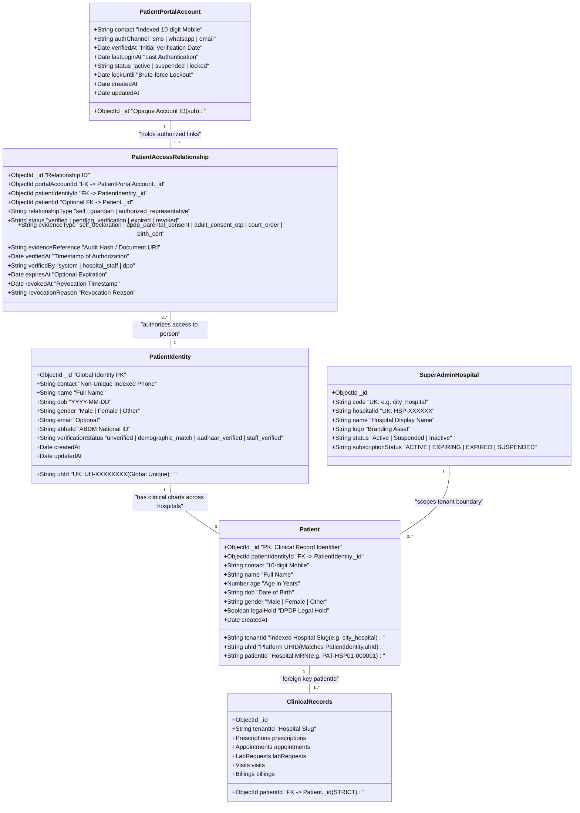
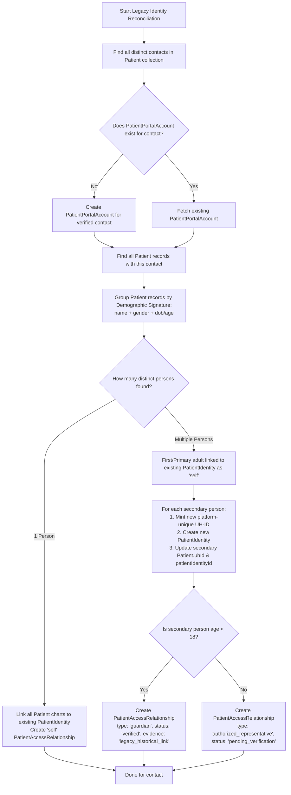
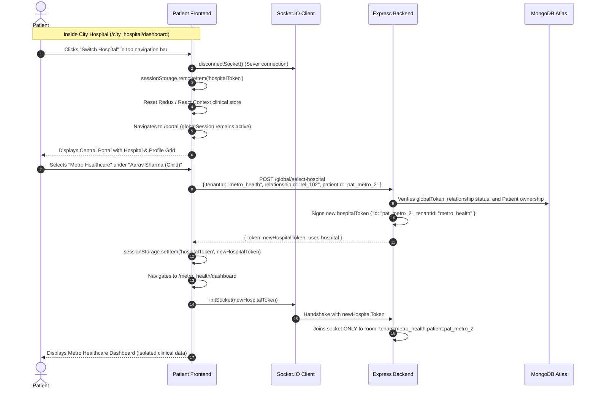

# QUROXA — GLOBAL PATIENT PORTAL
## ARCHITECTURAL REVISION 1.2 — PERSON-CENTRIC IDENTITY & FAMILY ACCESS SPECIFICATION

**Document Version:** 1.2.0  
**Status:** PROPOSED FOR IMPLEMENTATION (Revision 1.2 Final Architecture Specification)  
**Author:** Antigravity Engineering, Architecture & Information Security Team  
**Scope:** QUROXA Patient Frontend, Shared Express Backend & MongoDB Atlas Architecture  
**Authorization Gate:** READ-ONLY ARCHITECTURAL REVIEW — Implementation is NOT authorized.

---

## 1. EXECUTIVE SUMMARY & ARCHITECTURAL FOUNDATION

### 1.1 The Paradigm Shift: From Mobile-Centric to Person-Centric Identity
In traditional Indian clinic management systems, mobile phone numbers have frequently been misconstrued as primary keys for human identities. As established during the Stage G.3 audit and Architecture Revision 1.1 review, this conflation introduces severe clinical, legal, and operational vulnerabilities:
1. **Clinical Safety Hazard**: Pediatric patients (infants, children) and elderly parents who share a primary contact with an account holder were erroneously assigned identical universal healthcare identifiers (UHIDs) or blocked from registration within the same hospital.
2. **Regulatory Non-Compliance (DPDP Act 2023)**: The Digital Personal Data Protection Act 2023 (Section 9 for children, Section 6 for adult data principals) requires verifiable consent and distinct rights for every data principal. Possessing an SMS OTP sent to a shared device does **not** constitute lawful authorization to inspect another adult's sensitive personal data (SPDI / medical records).
3. **Number Recycling & Family Realities**: In India, mobile numbers are recycled after 90 days of inactivity, and multi-generational households routinely share a single smartphone.

### 1.2 Architectural Decision: Selection of Option 1 (Person-Centric Identity)
The operator has formally approved **Option 1**, establishing the following foundational principles:
- **Human Beings Are Primary Entities**: Each individual patient possesses a distinct `PatientIdentity` record and a globally unique, platform-wide UHID (`UH-XXXXXXXX`).
- **Mobile Numbers Are Authentication Channels**: A phone number is a verified transport channel for OTP delivery and portal account credentials, **not** an individual person.
- **Explicit Authorization via Access Relationships**: Access between an authenticated portal account and an individual clinical patient record is mediated exclusively by an explicit `PatientAccessRelationship` document.
- **Strict Clinical Invariant**: All existing clinical collections (`Prescriptions`, `Appointments`, `LabRequests`, `Visits`, `Billings`) reference `Patient._id`. In all hospital-scoped sessions, `req.user.id === Patient._id` is strictly preserved.

---

## 2. VERIFIED DATABASE REALITY & ENTITY RELATIONSHIP MODEL

### 2.1 Complete Target Entity Relationship Model (ERD)



### 2.2 Schema Definitions

#### A. `PatientPortalAccount` (`models/PatientPortalAccount.js`)
Represents the authenticated credential holder accessing the QUROXA Patient Portal.
```javascript
const mongoose = require('mongoose');

const patientPortalAccountSchema = new mongoose.Schema({
  contact: {
    type: String,
    required: true,
    unique: true,
    index: true,
    trim: true,
    match: [/^[6-9]\d{9}$/, 'Must be a valid 10-digit Indian mobile number']
  },
  authChannel: {
    type: String,
    enum: ['sms', 'whatsapp', 'email'],
    default: 'sms'
  },
  status: {
    type: String,
    enum: ['active', 'suspended', 'locked'],
    default: 'active',
    index: true
  },
  verifiedAt: {
    type: Date,
    default: Date.now
  },
  lastLoginAt: {
    type: Date
  },
  failedLoginAttempts: {
    type: Number,
    default: 0
  },
  lockUntil: {
    type: Date
  }
}, { timestamps: true });

module.exports = mongoose.model('PatientPortalAccount', patientPortalAccountSchema);
```

#### B. `PatientAccessRelationship` (`models/PatientAccessRelationship.js`)
The legal authorization link binding a portal account to an individual patient.
```javascript
const mongoose = require('mongoose');

const patientAccessRelationshipSchema = new mongoose.Schema({
  portalAccountId: {
    type: mongoose.Schema.Types.ObjectId,
    ref: 'PatientPortalAccount',
    required: true,
    index: true
  },
  patientIdentityId: {
    type: mongoose.Schema.Types.ObjectId,
    ref: 'PatientIdentity',
    required: true,
    index: true
  },
  // Optional hospital-scoped link if relationship is restricted to a specific facility
  patientId: {
    type: mongoose.Schema.Types.ObjectId,
    ref: 'Patient',
    index: true
  },
  relationshipType: {
    type: String,
    enum: ['self', 'guardian', 'authorized_representative'],
    required: true,
    index: true
  },
  status: {
    type: String,
    enum: ['verified', 'pending_verification', 'expired', 'revoked'],
    default: 'verified',
    index: true
  },
  evidenceType: {
    type: String,
    enum: ['self_declaration', 'dpdp_parental_consent', 'adult_consent_otp', 'court_order', 'birth_cert', 'staff_verified'],
    required: true
  },
  evidenceReference: {
    type: String,
    default: ''
  },
  consentMetadata: {
    ipAddress: { type: String, default: '' },
    userAgent: { type: String, default: '' },
    signedAt: { type: Date, default: Date.now }
  },
  verifiedAt: {
    type: Date,
    default: Date.now
  },
  verifiedBy: {
    type: String,
    default: 'system'
  },
  expiresAt: {
    type: Date
  },
  revokedAt: {
    type: Date
  },
  revocationReason: {
    type: String,
    default: ''
  }
}, { timestamps: true });

// Prevent duplicate active relationships between the same portal account and identity
patientAccessRelationshipSchema.index(
  { portalAccountId: 1, patientIdentityId: 1, relationshipType: 1 },
  { unique: true }
);

module.exports = mongoose.model('PatientAccessRelationship', patientAccessRelationshipSchema);
```

#### C. `PatientIdentity` (`models/PatientIdentity.js`)
Represents the individual human being with a globally unique UHID.
```javascript
const mongoose = require('mongoose');

const patientIdentitySchema = new mongoose.Schema({
  uhId: {
    type: String,
    required: true,
    unique: true,
    uppercase: true,
    trim: true,
    match: [/^UH-[A-Z0-9]{8}$/, 'uhId must match format UH-XXXXXXXX with 8 uppercase alphanumeric characters']
  },
  contact: {
    type: String,
    required: true,
    index: true, // NON-UNIQUE: multiple family members can share a contact number
    trim: true
  },
  name: {
    type: String,
    required: true,
    trim: true
  },
  dob: {
    type: String,
    default: ''
  },
  gender: {
    type: String,
    enum: ['Male', 'Female', 'Other', 'Unknown'],
    default: 'Unknown'
  },
  email: {
    type: String,
    lowercase: true,
    trim: true,
    default: ''
  },
  abhaId: {
    type: String,
    default: ''
  },
  verificationStatus: {
    type: String,
    enum: ['unverified', 'demographic_match', 'aadhaar_verified', 'staff_verified'],
    default: 'unverified'
  }
}, { timestamps: true });

// Indexes: uhId is unique; contact is non-unique index
patientIdentitySchema.index({ contact: 1 });

module.exports = mongoose.model('PatientIdentity', patientIdentitySchema);
```

#### D. `Patient` (`models/Patient.js`)
Hospital-scoped clinical chart. Preserves all existing fields and foreign key invariants.
```javascript
// In models/Patient.js:
// Additive foreign key linking clinical chart to individual global identity
patientIdentityId: { 
  type: mongoose.Schema.Types.ObjectId, 
  ref: 'PatientIdentity', 
  index: true 
}
```

---

## 3. PERSON-CENTRIC GLOBAL IDENTITY ARCHITECTURE

### 3.1 Individual Identity Principles
1. **Distinct UHID per Person**: Every patient, from newborn infant to adult account holder, is assigned an independent, globally unique UHID (`UH-XXXXXXXX`). Under no circumstances is a UHID shared between family members.
2. **Channel Separation**: A mobile number is recorded in `PatientPortalAccount` as the primary authentication factor and in `PatientIdentity` / `Patient` as a communication address.
3. **Multi-Profile Isolation**: A single portal account can access multiple `PatientIdentity` profiles only when an explicit, active `PatientAccessRelationship` document exists.

### 3.2 Comparison: Legacy vs V1.2 Architecture

| Aspect | Legacy Platform Architecture | Proposed V1.2 Person-Centric Architecture |
|---|---|---|
| **Identity Identifier** | Mobile number was the identity (`PatientIdentity.contact` had `{ unique: true }`). | Person is the identity (`PatientIdentity.uhId` unique, `PatientPortalAccount._id` for session). |
| **Family / Dependents** | Dependents forced to reuse the parent's UHID or registration was blocked. | Each child/dependent receives an independent UHID; linked via `PatientAccessRelationship`. |
| **Profile Access** | Anyone holding the SMS OTP could open any record sharing that phone number. | Access requires verified relationship (`self`, `guardian`, or DPDP-consented `representative`). |
| **Clinical Isolation** | `Patient.find({ contact })` mixed unrelated profiles if phone was recycled. | Access filtered strictly by `PatientAccessRelationship.find({ portalAccountId, status: 'verified' })`. |
| **Minor Protection** | No minor/adult distinction or parental consent capture. | Verifiable Parental Consent (VPC) under DPDP Act 2023 Section 9. |
| **Clinical Invariant** | `req.user.id === Patient._id` | `req.user.id === Patient._id` strictly preserved for all clinical controllers. |

---

## 4. GUARDIAN & REPRESENTATIVE AUTHORIZATION MODEL

### 4.1 Compliance with DPDP Act 2023
The Digital Personal Data Protection Act, 2023 sets stringent statutory obligations on Data Fiduciaries handling healthcare data:
- **Section 9(1) (Children's Data)**: A data fiduciary shall, before processing any personal data of a child, obtain verifiable consent of the parent of such child or lawful guardian.
- **Section 6 (Consent & Legitimate Uses)**: Processing of an adult's health data requires explicit, informed, and revocable consent.
- **Section 12 (Right to Withdraw Consent)**: The data principal has the right to revoke access at any time.

### 4.2 Three Authorization Tiers

```
┌─────────────────────────────────────────────────────────────────────────────────────────┐
│                               AUTHORIZATION TIERS                                      │
├─────────────────────────┬───────────────────────────────┬───────────────────────────────┤
│ Tier 1: SELF            │ Tier 2: GUARDIAN (MINOR < 18) │ Tier 3: REPRESENTATIVE (ADULT)│
├─────────────────────────┼───────────────────────────────┼───────────────────────────────┤
│ The account holder's    │ Minor ward under 18 years     │ Adult data principal (≥ 18)   │
│ personal medical record.│ of age.                       │ sharing a contact or device.  │
│                         │                               │                               │
│ Authorization:          │ Authorization:                │ Authorization:                │
│ Verified via direct     │ Verifiable Parental Consent   │ Explicit DPDP Delegation or   │
│ primary OTP on contact. │ (VPC) digital declaration.    │ Dual-Factor Consent OTP.      │
│                         │                               │                               │
│ Status:                 │ Status:                       │ Status:                       │
│ Automatically verified  │ Automatically verified upon   │ Requires explicit adult grant │
│ upon account creation.  │ VPC execution by parent.      │ or hospital desk verification.│
└─────────────────────────┴───────────────────────────────┴───────────────────────────────┘
```

### 4.3 Verifiable Parental Consent (VPC) Workflow for Minors
When an account holder adds or accesses a minor child (< 18 years):
1. **Age Determination**: Evaluated via `dob` or `age < 18`.
2. **Consent Declaration Screen**:
   > *"I, [Parent/Guardian Name], hereby declare that I am the legal parent/guardian of [Minor Child Name], born on [DOB]. In compliance with Section 9 of the DPDP Act 2023, I grant consent to access, view, and manage their clinical records on the QUROXA Platform."*
3. **Audit Evidence Capture**:
   - Relationship created with `relationshipType: 'guardian'`, `evidenceType: 'dpdp_parental_consent'`.
   - Captures: Client IP address, user-agent string, exact timestamp, guardian name, relationship confirmation.
4. **Transition to Adulthood**: When the minor reaches age 18, the system marks the relationship `expired`, prompting the now-adult patient to establish independent credentials or issue an adult representative authorization.

### 4.4 Adult Representative Authorization Workflow (Age ≥ 18)
Possession of a shared phone number does **not** grant automatic access to an adult's clinical history:
1. **Unlinked Demographic Match**: If an adult patient shares the mobile number, they appear in the discovery list as an unlinked record (`status: 'pending_verification'`).
2. **Access Methods**:
   - **Method A (Digital OTP Authorization)**: An authorization OTP is dispatched to the adult's personal email or secondary number, or an interactive consent screen is presented requiring the adult's physical presence and declaration.
   - **Method B (Desk/Staff Verification)**: Hospital registration staff inspects physical ID / legal power of attorney and marks `evidenceType: 'staff_verified'` via the hospital staff portal.
3. **Revocation Rights**: Any adult data principal can revoke an authorized representative immediately through the portal or via the Data Protection Officer (DPO).

---

## 5. INDEX STRATEGY & DATABASE REALITY

### 5.1 Current Production Index Configuration (Audited)

#### `PatientIdentity` Collection (`models/PatientIdentity.js`)
```javascript
// CURRENT STATE IN CODE:
uhId:    { type: String, required: true, unique: true }  // Index: uhId_1 (Unique)
contact: { type: String, required: true, unique: true }  // Index: contact_1 (Unique) - DEFECTIVE
```
*Current Defect*: The unique index on `contact_1` prevents creating distinct `PatientIdentity` documents for family members who share a phone number.

#### `Patient` Collection (`models/Patient.js`)
```javascript
// CURRENT STATE IN CODE:
patientSchema.index({ tenantId: 1, contact: 1 });
patientSchema.index({ tenantId: 1, patientId: 1 }, { unique: true, sparse: true });
patientSchema.index({ tenantId: 1, uhId: 1 }, { unique: true, sparse: true });
patientSchema.index({ uhId: 1 });
```
*Key Invariant*: `{ tenantId: 1, uhId: 1 }` is unique (sparse). Under person-centric identity, because each individual receives their own unique UHID, two family members at the same hospital will have different UHIDs and will **not** violate this index!

### 5.2 Required Index Migration Commands (Ready for Operator Authorization)

> [!CAUTION]
> **READ-ONLY EXECUTION NOTICE**: In accordance with Stage F.2 and Revision 1.2 rules, these commands are specified for planning purposes only. **No migration commands will be executed during this session.**

#### Step 1: MongoDB Shell / Atlas Script (Planned)
```javascript
// Step 1: Drop the obsolete unique index on contact
db.patientidentities.dropIndex("contact_1");

// Step 2: Create non-unique index on contact to support fast lookup by phone
db.patientidentities.createIndex({ contact: 1 }, { name: "contact_1", background: true });

// Step 3: Verify that uhId_1 remains uniquely indexed
// (uhId_1 MUST remain unique: { uhId: 1 }, { unique: true })

// Step 4: Create indexes for new collections
db.patientportalaccounts.createIndex({ contact: 1 }, { unique: true, name: "contact_unique" });
db.patientaccessrelationships.createIndex(
  { portalAccountId: 1, patientIdentityId: 1, relationshipType: 1 }, 
  { unique: true, name: "account_identity_relationship_unique" }
);
db.patientaccessrelationships.createIndex({ portalAccountId: 1, status: 1 }, { name: "account_status_idx" });
db.patientaccessrelationships.createIndex({ patientIdentityId: 1 }, { name: "identity_idx" });
```

#### Step 2: Mongoose Schema Alignment
Update `models/PatientIdentity.js`:
```javascript
// Replace:
// contact: { type: String, required: true, unique: true, index: true }
// With:
contact: { type: String, required: true, index: true }
```

### 5.3 Duplicate Conflict Risk Analysis
- **In `PatientIdentity`**: Currently `contact` has been unique, meaning there are zero duplicate contacts in `PatientIdentity`. Dropping the unique index and rebuilding a non-unique index is mathematically safe and cannot produce duplicate key errors.
- **In `Patient`**: Multiple `Patient` records across different hospitals (`tenantId`) already share contacts without error because `{ tenantId: 1, contact: 1 }` is non-unique.
- **In `patientRoutes.js` (Backend Controller Check)**: Line 87 contains a programmatic query blocking duplicate contacts within a tenant (`existingContactPatient = await Patient.findOne({ tenantId, contact })`). This programmatic check must be amended during Phase 1 implementation to allow dependent registration when an authorized `PatientAccessRelationship` is present.

---

## 6. LEGACY IDENTITY RECONCILIATION PLAN

### 6.1 Reconciling Historical `PatientIdentity` Records
In the existing MongoDB Atlas cluster:
1. Every existing `PatientIdentity` record was created under the legacy `resolveOrCreateUhid` function.
2. The person who was registered first holds that `PatientIdentity` document.
3. If multiple `Patient` records share that phone number, they were previously linked to that single UHID.

### 6.2 Data Reconciliation Procedure
A non-destructive reconciliation migration will run during Phase 1:



### 6.3 Preservation of Clinical Invariants
- **`Patient._id` is NEVER modified**: Every prescription, appointment, lab result, bill, and clinical note references `Patient._id`. This field is immutable.
- **`tenantId` is NEVER modified**: Clinical boundary isolation is 100% maintained.
- **Demographic Disambiguation Heuristic**: Two records sharing a contact are treated as distinct individuals if:
  - Names differ significantly (Levenshtein distance > 3 and initials do not match).
  - Genders differ (e.g. Male vs Female).
  - Ages differ by more than 5 years.

---

## 7. REVISED API CONTRACTS

### 7.1 POST `/api/auth/patient-portal/global/send-otp`
Initiates global portal authentication.
- **Rate Limit**: 5 requests / 10 minutes; 30-second cooldown per mobile.
- **Request Payload**:
  ```json
  {
    "mobile": "9876543210"
  }
  ```
- **Execution**:
  - Validates Indian mobile format (`^[6-9]\d{9}$`).
  - Creates or refreshes `OtpChallenge` with `tenantId: 'global'`, `purpose: 'GLOBAL_PATIENT_AUTH'`.
  - Dispatches SMS OTP via configured SMS Gateway (Mock/Twilio/Fast2SMS).
- **Response (`200 OK`)**:
  ```json
  {
    "success": true,
    "channel": "sms",
    "maskedTarget": "+91 98*** **210",
    "cooldownSeconds": 30
  }
  ```

---

### 7.2 POST `/api/auth/patient-portal/global/verify-otp`
Verifies OTP and returns the Global Portal Session and authorized profiles.
- **Request Payload**:
  ```json
  {
    "mobile": "9876543210",
    "otp": "842109"
  }
  ```
- **Execution**:
  1. Atomically verifies and consumes `OtpChallenge`.
  2. Finds or creates `PatientPortalAccount` for `contact: normalizedMobile`.
  3. Queries `PatientAccessRelationship.find({ portalAccountId: account._id, status: 'verified' })`.
  4. Queries associated `PatientIdentity` and `Patient` documents.
  5. Queries `SuperAdminHospital.find({ code: { $in: tenantIds }, status: 'Active', subscriptionStatus: { $in: ['ACTIVE', 'EXPIRING'] } })`.
  6. Signs short-lived `globalToken` (15-30m) with opaque `sub: account._id`.
- **Response (`200 OK`)**:
  ```json
  {
    "status": "success",
    "globalToken": "eyJhbGciOi...",
    "account": {
      "accountId": "ppa_67375a1...",
      "contact": "+91 98*** **210"
    },
    "profiles": [
      {
        "relationshipId": "rel_101",
        "patientIdentityId": "pid_201",
        "uhId": "UH-8F42K7D1",
        "name": "Ramesh Sharma",
        "relationshipType": "self",
        "isDependent": false,
        "hospitals": [
          {
            "tenantId": "city_hospital",
            "hospitalId": "HSP-DM5UDO",
            "name": "City Hospital",
            "logo": "C",
            "patientId": "pat_001"
          }
        ]
      },
      {
        "relationshipId": "rel_102",
        "patientIdentityId": "pid_202",
        "uhId": "UH-3B91X4M2",
        "name": "Aarav Sharma",
        "relationshipType": "guardian",
        "isDependent": true,
        "hospitals": [
          {
            "tenantId": "city_hospital",
            "hospitalId": "HSP-DM5UDO",
            "name": "City Hospital",
            "logo": "C",
            "patientId": "pat_002"
          }
        ]
      }
    ],
    "unlinkedProfiles": [
      {
        "temporaryId": "unl_301",
        "maskedName": "S**** S****** (Adult)",
        "relationshipType": "authorized_representative",
        "verificationRequired": true,
        "reason": "DPDP Adult Consent Required"
      }
    ],
    "isNewUser": false
  }
  ```

---

### 7.3 POST `/api/auth/patient-portal/global/select-hospital`
Exchanges the global token and verified relationship for a hospital-scoped clinical token.
- **Headers**: `Authorization: Bearer <globalToken>`
- **Request Payload**:
  ```json
  {
    "tenantId": "city_hospital",
    "relationshipId": "rel_101",
    "patientId": "pat_001"
  }
  ```
- **Execution & Security Verification**:
  1. Validates `globalToken` (`token_use === 'global_portal'`, not expired, not revoked).
  2. Verifies `PatientAccessRelationship.findOne({ _id: relationshipId, portalAccountId: decoded.sub, status: 'verified' })`.
  3. Verifies `Patient.findOne({ _id: patientId, tenantId })`.
  4. Confirms that `patient.patientIdentityId.toString() === relationship.patientIdentityId.toString()`.
  5. Validates hospital status: `SuperAdminHospital.findOne({ code: tenantId, status: 'Active', subscriptionStatus: { $in: ['ACTIVE', 'EXPIRING'] } })`.
  6. Signs Hospital Clinical Access Token:
     ```javascript
     jwt.sign({
       id: patientDoc._id,          // CRITICAL INVARIANT: req.user.id === Patient._id
       userId: userDoc._id,
       role: 'patient',
       tenantId: patientDoc.tenantId,
       uhId: patientDoc.uhId,
       relationshipId: relationship._id,
       token_use: 'hospital_clinical'
     }, getJwtSecret(), { expiresIn: '12h' });
     ```
- **Response (`200 OK`)**:
  ```json
  {
    "status": "success",
    "token": "eyJhbGciOi...",
    "user": {
      "id": "pat_001",
      "role": "patient",
      "tenantId": "city_hospital",
      "name": "Ramesh Sharma",
      "uhId": "UH-8F42K7D1"
    },
    "hospital": {
      "tenantId": "city_hospital",
      "name": "City Hospital",
      "logo": "C"
    }
  }
  ```

---

### 7.4 Relationship Management APIs

#### A. GET `/api/auth/patient-portal/global/relationships`
Retrieves all access relationships (verified, pending, revoked) associated with the account.
- **Headers**: `Authorization: Bearer <globalToken>`
- **Response (`200 OK`)**:
  ```json
  {
    "success": true,
    "relationships": [
      {
        "id": "rel_101",
        "name": "Ramesh Sharma",
        "uhId": "UH-8F42K7D1",
        "relationshipType": "self",
        "status": "verified",
        "verifiedAt": "2026-11-01T10:00:00Z"
      },
      {
        "id": "rel_102",
        "name": "Aarav Sharma",
        "uhId": "UH-3B91X4M2",
        "relationshipType": "guardian",
        "status": "verified",
        "verifiedAt": "2026-11-05T14:30:00Z"
      }
    ]
  }
  ```

#### B. POST `/api/auth/patient-portal/global/request-access`
Submits a verifiable parental consent (VPC) or requests representative access.
- **Headers**: `Authorization: Bearer <globalToken>`
- **Request Payload (Minor Dependent / Ward)**:
  ```json
  {
    "relationshipType": "guardian",
    "dependentDetails": {
      "name": "Ananya Sharma",
      "dob": "2020-04-12",
      "gender": "Female"
    },
    "consentDeclaration": {
      "declarationAccepted": true,
      "guardianName": "Ramesh Sharma",
      "declarationText": "I declare under Section 9 DPDP Act 2023 that I am the legal guardian."
    }
  }
  ```
- **Response (`201 Created`)**:
  ```json
  {
    "success": true,
    "relationshipId": "rel_103",
    "patientIdentityId": "pid_203",
    "uhId": "UH-7K82N9Q4",
    "status": "verified"
  }
  ```

#### C. POST `/api/auth/patient-portal/global/relationships/:id/revoke`
Revokes an existing access relationship immediately.
- **Headers**: `Authorization: Bearer <globalToken>`
- **Response (`200 OK`)**:
  ```json
  {
    "success": true,
    "message": "Access relationship successfully revoked. Token re-issuance is permanently blocked.",
    "revokedAt": "2026-11-16T10:45:00Z"
  }
  ```

---

## 8. TOKEN SECURITY & IDENTIFIERS

### 8.1 Global Portal Session Token
- **Target Audience**: QUROXA Global Patient Portal (`/portal`).
- **Subject (`sub`)**: Opaque `PatientPortalAccount._id` (e.g. `ppa_67375a1...`). **Raw mobile number is NEVER used as `sub`.**
- **Token Claims**:
  ```json
  {
    "iss": "quroxa-auth-engine",
    "aud": "quroxa-patient-portal",
    "sub": "ppa_67375a14c2b9f001",
    "token_use": "global_portal",
    "contactMasked": "+91 98*** **210",
    "jti": "550e8400-e29b-41d4-a716-446655440000",
    "iat": 1794720000,
    "exp": 1794721200
  }
  ```
- **Lifespan**: 15–30 minutes (Strict short expiration).
- **Server-Side Revocation**: Each logout or security event records the `jti` in a fast-lookup Redis/MongoDB collection (`RevokedToken.create({ jti, expiresAt })`).

### 8.2 Hospital-Scoped Clinical Access Token
- **Target Audience**: Hospital Clinical Backend APIs (`/api/prescriptions`, `/api/appointments`, `/api/labs`).
- **Subject (`sub`) / ID**: `Patient._id` (Immutable clinical anchor).
- **Token Claims**:
  ```json
  {
    "iss": "quroxa-auth-engine",
    "aud": "quroxa-hospital-clinical",
    "id": "67375b28d3...",
    "userId": "67375b28d4...",
    "role": "patient",
    "tenantId": "city_hospital",
    "uhId": "UH-8F42K7D1",
    "relationshipId": "rel_101",
    "token_use": "hospital_clinical",
    "iat": 1794720000,
    "exp": 1794763200
  }
  ```
- **Lifespan**: 12 hours.

### 8.3 Enforcement of the Clinical Boundary
All clinical controllers execute `verifyToken` middleware. `verifyToken` performs strict claim assertion:
```javascript
// Enforcement in middleware/authMiddleware.js:
if (decoded.token_use !== 'hospital_clinical' || !decoded.tenantId || decoded.role !== 'patient') {
  return res.status(403).json({ 
    error: 'Access denied: Hospital clinical authorization required.', 
    code: 'GLOBAL_TOKEN_CANNOT_ACCESS_CLINICAL_API' 
  });
}
```
Any attempt to access clinical records using a `globalToken` results in immediate **HTTP 403 Forbidden**.

---

## 9. COMPLETE PATIENT REGISTRATION JOURNEYS

### 9.1 Journey A: New Individual Self-Registration
1. User enters mobile number at `/login`.
2. OTP verified via `POST /global/verify-otp`.
3. Account created in `PatientPortalAccount`.
4. Portal detects zero linked profiles; navigates to `/portal` onboarding.
5. User selects desired clinic (e.g. City Hospital).
6. Portal dispatches `POST /global/issue-registration-token` returning a single-use registration token.
7. User fills out demographics (Name, DOB, Gender, Address).
8. Backend creates:
   - `PatientIdentity` (Generates new platform-unique UHID: `UH-XXXXXXXX`).
   - `PatientAccessRelationship` (`relationshipType: 'self'`, `status: 'verified'`).
   - `Patient` (Scoped to `tenantId: 'city_hospital'`).
9. User is immediately issued hospital token and directed to `/city_hospital/dashboard`.

### 9.2 Journey B: Parent Registering a Minor Child (Ward < 18)
1. Authenticated parent in `/portal` clicks *"Add Family Member"*.
2. Selects *"My Minor Child (< 18 years)"*.
3. Enters child's details: Name, DOB, Gender.
4. Executes the DPDP Section 9 Verifiable Parental Consent digital declaration.
5. Backend executes:
   - Generates distinct `uhId` for child (e.g. `UH-99A1B2C3`).
   - Creates `PatientIdentity` with child's name, DOB, and parent's contact.
   - Creates `PatientAccessRelationship` with `relationshipType: 'guardian'`, `evidenceType: 'dpdp_parental_consent'`.
6. Child's profile appears instantly in parent's profile selector for appointment booking.

### 9.3 Journey C: Adult Family Member Onboarding (Explicit Consent)
1. Authenticated user clicks *"Add Family Member"* and selects *"Adult Family Member (≥ 18)"*.
2. Enters adult's details and relationship (Spouse, Elderly Parent).
3. System displays statutory DPDP notice: *"Adult medical records require explicit consent."*
4. System offers two verification channels:
   - Dispatches a verification link / OTP to the adult's personal contact.
   - Or marks relationship as `pending_verification` to be confirmed at hospital reception desk.
5. Only once verified does the profile unlock in the portal.

### 9.4 Journey D: Linking an Existing Hospital Patient to a Portal Account
1. Patient was registered offline at a clinic reception desk before using the portal.
2. Patient logs into `/login` with the same mobile number.
3. Portal displays: *"We found 1 existing clinical profile matching your phone number."*
4. Patient confirms identity by verifying their Year of Birth or National ID (ABHA / Aadhaar last 4 digits).
5. Backend creates `PatientAccessRelationship` (`relationshipType: 'self'`, `evidenceType: 'self_declaration'`).
6. Profile is immediately unlocked.

---

## 10. MULTI-HOSPITAL SESSION SWITCHING SEQUENCE



### Cache & Session Isolation Invariants
1. **Zero State Carry-Over**: All React state relating to appointments, prescriptions, bills, and lab results is wiped synchronously upon leaving a hospital dashboard.
2. **WebSocket Isolation**: Socket disconnection is mandatory before switching. Sockets are joined exclusively to tenant-scoped rooms (`tenant:<tenantId>:patient:<patientId>`).
3. **Cross-Tenant Request Rejection**: If an API request to `https://curoxa.onrender.com/api/prescriptions` carries a token for `city_hospital` while requesting a `metro_health` resource, the backend middleware traps the tenant mismatch and returns **HTTP 403 Forbidden**.

---

## 11. BACKWARD COMPATIBILITY & LEGACY RESOLUTION

| Route / Parameter | Behavior in V1.2 Architecture | Security & Backward Compatibility Guarantee |
|---|---|---|
| **`/:hospitalSlug/login` (Bookmarked / SMS Link)** | Redirects to `/login?redirectHospital=:hospitalSlug`. | Fully preserved. Legacy appointment reminder SMS links continue functioning without 404 errors. |
| **`redirectHospital` Parameter** | Validated against regex `/^[a-z0-9_-]{3,32}$/` and queried against `SuperAdminHospital.findOne({ code, status: 'Active' })`. | Eliminates open-redirect vulnerabilities. If the user holds a verified profile at that hospital, it auto-selects upon login. |
| **Legacy Endpoints (`/patient-portal/send-otp`, `/verify-otp`)** | Unmodified in `authRoutes.js`. | Staff portal patient login (`curoxa-1.onrender.com/patient/login`) continues working with 100% regression freedom. |
| **Staff Frontend (`curoxa-1.onrender.com`)** | Zero modifications required. | Completely unaffected. |

---

## 12. SECURITY TEST MATRIX (16 TEST SCENARIOS)

| Test ID | Security Scenario | Target Layer | Expected Result & Validation |
|---|---|---|---|
| **SEC-1.2-01** | Global OTP Send with valid mobile | `POST /global/send-otp` | 200 OK; challenge stored under `tenantId: 'global'`, purpose `'GLOBAL_PATIENT_AUTH'`. |
| **SEC-1.2-02** | Global OTP Rate Limit (6 requests / 5m) | `POST /global/send-otp` | 6th request blocked with `429 Too Many Requests`. |
| **SEC-1.2-03** | Brute-force OTP lockout (5 failed tries) | `POST /global/verify-otp` | 5th bad attempt triggers 15m account lockout (`429 Account Locked`). |
| **SEC-1.2-04** | Single-use OTP replay attempt | `POST /global/verify-otp` | Replayed OTP rejected with `400 Code already consumed`. |
| **SEC-1.2-05** | Global token clinical API access attempt | `GET /api/prescriptions` with `globalToken` | **403 Forbidden** (`code: 'GLOBAL_TOKEN_CANNOT_ACCESS_CLINICAL_API'`). |
| **SEC-1.2-06** | Global token Socket.IO handshake attempt | WebSocket with `globalToken` | Connection severed during handshake (`Missing tenantId in credentials`). |
| **SEC-1.2-07** | Opaque Subject claim validation | `globalToken` inspection | JWT `sub` is opaque `PatientPortalAccount._id`; mobile number is absent from `sub`. |
| **SEC-1.2-08** | Unauthorized dependent profile selection | `POST /global/select-hospital` with non-owned `patientId` | **403 Forbidden** (`Access relationship not authorized for this account`). |
| **SEC-1.2-09** | Minor ward access without VPC consent | `POST /global/select-hospital` for minor without consent | **403 Forbidden** (`DPDP Section 9 Parental Consent Required`). |
| **SEC-1.2-10** | Adult family member access without consent | `POST /global/select-hospital` for unconsented adult | **403 Forbidden** (`Data Principal Consent Required`). |
| **SEC-1.2-11** | Revoked relationship access attempt | `POST /global/select-hospital` on revoked relationship | **403 Forbidden** (`Access relationship has been revoked`). |
| **SEC-1.2-12** | Distinct UHID generation for family members | Register parent + child on same phone | Parent and child receive distinct UHIDs (`UH-XXXXXXXX`); neither overwrites the other. |
| **SEC-1.2-13** | Suspended hospital access attempt | `POST /global/select-hospital` on suspended clinic | **403 Forbidden** (`Hospital subscription is suspended`). |
| **SEC-1.2-14** | Inactive hospital discovery exclusion | `POST /global/verify-otp` | Inactive, pending, or onboarding hospitals are strictly omitted from discovery. |
| **SEC-1.2-15** | Cross-hospital session isolation | Switch from Hospital A to Hospital B | Socket A disconnects; Socket B joins ONLY Room B; React clinical state purged. |
| **SEC-1.2-16** | Cross-tenant token tampering | Submit Hospital A token to Hospital B endpoint | Backend middleware enforces `req.tenantId === decoded.tenantId`; returns **403 Forbidden**. |

---

## 13. ROLLBACK PLAN & OUTSTANDING ARCHITECTURAL DECISIONS

### 13.1 Rollback Procedures

#### Database Index Rollback
If the index changes must be rolled back:
1. Re-add the unique constraint on `contact` in `PatientIdentity`:
   ```javascript
   // CAUTION: Will fail if duplicate contacts exist
   db.patientidentities.createIndex({ contact: 1 }, { unique: true, name: "contact_1_unique" });
   ```
2. Drop new collections if necessary:
   ```javascript
   db.patientaccessrelationships.drop();
   db.patientportalaccounts.drop();
   ```

#### Backend Code Rollback
- New routes are mounted on distinct paths (`/api/auth/patient-portal/global/*`).
- Rolling back backend code involves reverting to commit `2b3e41577ffc2cb40f6b3ec219808a3d537aa246`.
- Legacy patient and staff routes remain completely untouched and require zero rollback action.

### 13.2 Outstanding Architectural Decisions
1. **Adult Family Member Secondary Verification Mechanism**:
   - *Option A*: Interactive in-person digital declaration (Account holder affirms adult is present and consenting).
   - *Option B*: Dual-OTP (Dispatches a second SMS OTP to a secondary phone or email registered for that adult).
   - *Recommendation*: Support Option A for initial portal beta, with Option B available for high-sensitivity clinics.
2. **Global Session Token Storage in Frontend**:
   - *Option A*: `sessionStorage` (cleared on tab close; maximum security).
   - *Option B*: `localStorage` (persists across tabs; requires manual logout).
   - *Recommendation*: Use `sessionStorage` for hospital tokens and `localStorage` for `globalToken` with automatic 30-minute idle expiration.

---

## 14. PROPOSAL CLASSIFICATION & FINAL RECOMMENDATION

The Revision 1.2 architecture fully resolves the person-centric identity requirements, implements statutory DPDP Act 2023 protections for minors and adult data principals, hardens token security with opaque account identifiers, and guarantees zero clinical regression on existing hospital records.

### Architectural Recommendation:
**APPROVED FOR IMPLEMENTATION**

---
*End of Architectural Specification V1.2. Awaiting separate operator authorization for Phase 1 implementation.*
