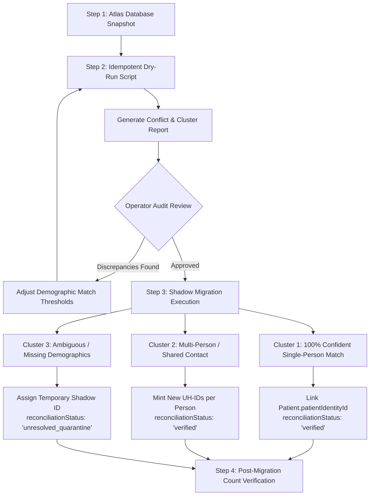
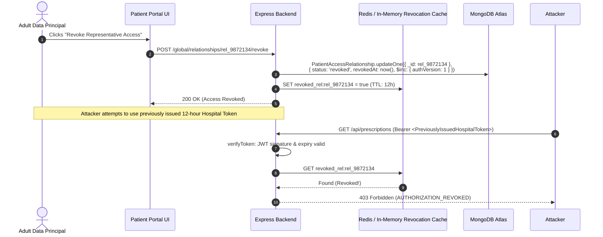

# QUROXA — GLOBAL PATIENT PORTAL
## ARCHITECTURAL REVISION 1.3 — ACCOUNT AUTHENTICATION, IDENTITY MAPPING & REVOCATION SPECIFICATION

**Document Version:** 1.3.0  
**Status:** PROPOSED FOR STAGING IMPLEMENTATION (Revision 1.3 Architecture Specification)  
**Author:** Antigravity Engineering, Clinical Systems Architecture & Security Governance Team  
**Scope:** QUROXA Patient Frontend, Shared Express Backend, MongoDB Atlas, & Stage D Clinical Ecosystem  
**Authorization Gate:** READ-ONLY ARCHITECTURAL REVIEW — Implementation is NOT authorized.

---

## 1. OBJECTIVE & EXECUTIVE OVERVIEW

### 1.1 Objective
Finalize the remaining authentication, identity-mapping, guardian authorization, and server-side revocation mechanisms required to implement **Option 1 (Person-Centric Patient Identity)** across the QUROXA platform.

This specification builds directly upon Revisions 1.1 and 1.2, preserving the canonical four-step patient journey:
1. **Global QUROXA Login**: Fast, secure mobile entry point (`/login`).
2. **Authenticated Global Patient Portal**: Central management hub (`/portal`) displaying verified patient profiles and associated healthcare facilities.
3. **Associated Hospital Selection**: Explicit clinic and profile selection.
4. **Hospital-Specific Clinical Dashboard**: Tenant-scoped medical chart (`/:hospitalSlug/dashboard`).

### 1.2 Core Architectural Invariants Maintained
- **Zero Redesign of Stage D Clinical Modules**: The existing backend clinical controllers (`Prescription`, `Appointment`, `LabRequest`, `Visit`, `Billing`) and staff portal (`curoxa-1.onrender.com`) are preserved without regression.
- **Strict Clinical Invariant**: In all hospital-scoped sessions, `req.user.id === Patient._id` is strictly enforced.
- **Strict Tenant Isolation**: Hospital clinical data cannot be queried across tenants; clinical requests reject global portal tokens with **HTTP 403 Forbidden**.
- **No Inferred Authority**: Neither possession of an SMS OTP nor sharing a mobile phone number constitutes proof of personhood, guardian standing, or lawful authorization under the Digital Personal Data Protection (DPDP) Act, 2023.

---

## 2. SHARED MOBILE NUMBER & MULTI-ACCOUNT AUTHENTICATION

### 2.1 The Shared-Device Multi-Adult Problem
In Indian healthcare demographics, a single mobile number is frequently shared by multiple individuals within a household (e.g. Father, Mother, and Minor Child). 

```
Shared Mobile Number: +91 98765 43210
  ├── Adult A (Father): Ramesh Sharma (Holds individual PatientIdentity & medical chart)
  ├── Adult B (Mother): Sunita Sharma (Holds individual PatientIdentity & medical chart)
  └── Minor C (Child):  Aarav Sharma  (Holds individual PatientIdentity & pediatric chart)
```

If the system simply authenticates the phone number and displays all names, three critical failures occur:
1. **Confidentiality Breach**: Mother's presence and treatment history are disclosed to Father (or anyone holding the phone) before secondary authentication.
2. **Unauthorized Proxy Access**: Anyone reading the SMS OTP can impersonate another adult and review their confidential medical history (violating DPDP Act Section 6 & SPDI Rules).
3. **Identity Conflation**: The portal cannot determine which human being is establishing the authenticated global session.

### 2.2 Channel Verification vs. Account Authentication

Authentication is strictly decoupled into a two-phase protocol:

```
┌────────────────────────────────────────────────────────────────────────┐
│ PHASE 1: CHANNEL POSSESSION VERIFICATION (Transport Level)             │
│ • Input: Mobile Number (+91 98765 43210)                               │
│ • Challenge: 6-digit cryptographic SMS OTP                             │
│ • Outcome: Verifies control of the communication channel ONLY.         │
│ • Does NOT identify the person. Does NOT issue a session token.        │
│ • Yields: Ephemeral PreAuth Token (TTL: 5 minutes, single-purpose).    │
└───────────────────────────────────┬────────────────────────────────────┘
                                    │
                                    ▼
┌────────────────────────────────────────────────────────────────────────┐
│ PHASE 2: INDIVIDUAL ACCOUNT AUTHENTICATION (Person Level)              │
│ • Input: PreAuth Token + Account-Specific Security Factor (PIN/Passkey)│
│ • Challenge: 6-digit Account Security PIN or FIDO2/WebAuthn Passkey.   │
│ • Outcome: Proves individual identity of the specific adult.           │
│ • Yields: Global Session Token bound to that individual's              │
│   PatientPortalAccount._id (Opaque 'sub'). Zero identity leakage.      │
└────────────────────────────────────────────────────────────────────────┘
```

### 2.3 Account Identification Without Identity Leakage
When multiple adult accounts are registered under a single phone number:
1. **Zero Demographics in Phase 1 Response**: The response to `POST /global/verify-otp` **never** returns plain-text patient names, ages, or UHIDs.
2. **Account Disambiguation via Account PIN or FIDO2 Passkey**:
   - Each adult establishes their own `PatientPortalAccount` with a personal **6-digit Account Security PIN** (hashed with Argon2id / bcrypt) or registers a **device biometric passkey** (WebAuthn / FIDO2).
   - If multiple accounts exist for the phone, the API returns an obfuscated account count and slot index, or prompts:
     > *"Enter your personal 6-digit Account Security PIN or use Fingerprint / Face ID to unlock your profile."*
   - The user enters their PIN. The backend attempts verification against the candidate accounts linked to that phone number.
   - Upon a valid PIN match, that specific `PatientPortalAccount` is loaded.
   - If an account holder has not yet set a PIN (e.g. legacy migrated account), they are prompted to verify their personal Year of Birth (YOB) and select a new 6-digit PIN before any clinical records are unlocked.
3. **Minor Children Access**:
   - Minor children **do not** hold independent `PatientPortalAccount` credentials.
   - A minor child's records are accessed exclusively through an authenticated parent/guardian account via a verified `PatientAccessRelationship`.

### 2.4 Mobile Number Recycling & SIM Reassignment
Telecom operators in India recycle inactive prepaid numbers after 90 days. A new subscriber receiving a recycled number must never gain access to the previous subscriber's health history:
1. **Recycled SIM Defense**:
   - When the new SIM owner enters the phone number and verifies the SMS OTP, they do **not** possess the previous owner's Account Security PIN.
   - After 3 failed PIN attempts, or if the user selects *"This is a new number / I am a new user"*, the portal initiates fresh account registration.
2. **Orphaned Account Quarantine**:
   - The previous account is marked `status: 'orphaned_contact_recycled'`.
   - The phone number is unlinked from the previous owner's `PatientPortalAccount`.
   - The previous owner's clinical history remains safely preserved under their permanent `PatientIdentity.uhId` and `Patient._id`.
   - The previous owner can re-bind their account to their new mobile number by visiting any affiliated hospital reception desk with government-issued photo ID (Aadhaar / Passport / Voter ID).

---

## 3. PATIENT-TO-IDENTITY MAPPING

### 3.1 Schema Relationship Model: `Patient.patientIdentityId`
To establish an unambiguous relationship between universal human identities and hospital-specific charts, the `Patient` model incorporates an explicit foreign key:

```javascript
// models/Patient.js (Additive schema field)
patientIdentityId: {
  type: mongoose.Schema.Types.ObjectId,
  ref: 'PatientIdentity',
  required: false, // Sparse during phased migration; required for new registrations
  index: true
},
reconciliationStatus: {
  type: String,
  enum: ['verified', 'unresolved_quarantine', 'manual_review', 'legacy_unlinked'],
  default: 'legacy_unlinked',
  index: true
},
isMergedAlias: {
  type: Boolean,
  default: false,
  index: true
},
mergedIntoPatientId: {
  type: mongoose.Schema.Types.ObjectId,
  ref: 'Patient'
}
```

```
┌────────────────────────────────────────────────────────────────────────┐
│                        PATIENT IDENTITY MAPPING                        │
├────────────────────────────────────────────────────────────────────────┤
│                     PatientIdentity (Global Individual)                │
│                     _id: pid_101                                       │
│                     uhId: "UH-8F42K7D1"                                │
│                     name: "Ramesh Sharma"                              │
│                     dob: "1980-05-15", gender: "Male"                  │
└──────────────────┬─────────────────────────────────┬───────────────────┘
                   │                                 │
                   ▼                                 ▼
┌─────────────────────────────────────┐ ┌────────────────────────────────┐
│ Patient (City Hospital Chart)       │ │ Patient (Metro Health Chart)   │
│ _id: pat_city_001                   │ │ _id: pat_metro_002             │
│ tenantId: "city_hospital"           │ │ tenantId: "metro_health"       │
│ patientIdentityId: pid_101          │ │ patientIdentityId: pid_101     │
│ patientId: "PAT-HSP01-0001"         │ │ patientId: "PAT-HSP02-0045"    │
│ uhId: "UH-8F42K7D1"                 │ │ uhId: "UH-8F42K7D1"            │
│ Prescriptions, Labs, Appointments   │ │ Prescriptions, Labs, Visits    │
└─────────────────────────────────────┘ └────────────────────────────────┘
```

### 3.2 Mapping Invariants & Constraints
1. **1:1 Mapping per Individual per Facility**: An individual `PatientIdentity` should map to exactly one active `Patient` record per `tenantId`.
2. **Multi-Facility Mapping**: When an individual visits multiple facilities in the QUROXA network, distinct `Patient` records are created across facilities (`pat_city_001`, `pat_metro_002`), each storing the **same** `patientIdentityId: pid_101` and the same universal `uhId: "UH-8F42K7D1"`.
3. **No Cross-Family Collapsing**: Family members who share a phone number must **never** be mapped to the same `patientIdentityId`.
4. **Quarantine of Unverified Records**: Any legacy record where `reconciliationStatus === 'unresolved_quarantine'` is excluded from global portal auto-discovery until verified.

### 3.3 Intra-Tenant Duplicate Resolution (Accidental Duplicate Hospital Charts)
In clinical operations, receptionists occasionally create duplicate charts for the same patient (e.g. searching "Ramesh Sharma" vs "Ramesh K Sharma").
- **Resolution Strategy (Merge / Alias Model)**:
  - The older, clinically primary chart retains `isMergedAlias: false`.
  - The duplicate chart is updated with `isMergedAlias: true` and `mergedIntoPatientId: primaryPatientDoc._id`.
  - **Foreign Key Preservation**: Historical prescriptions, visits, and bills referencing the duplicate `Patient._id` are **not** rewritten. They remain permanently linked to that `Patient._id` for legal and medico-legal audit integrity.
  - The patient portal groups clinical documents across both alias records under the unified `patientIdentityId`.

### 3.4 Target Database Indexes
```javascript
// Patient Collection Indexes
patientSchema.index({ patientIdentityId: 1 });
patientSchema.index({ tenantId: 1, patientIdentityId: 1, isMergedAlias: 1 });
patientSchema.index({ tenantId: 1, reconciliationStatus: 1 });

// PatientIdentity Collection Indexes
patientIdentitySchema.index({ uhId: 1 }, { unique: true });
patientIdentitySchema.index({ contact: 1 }); // Non-unique
```

---

## 4. LEGACY IDENTITY RECONCILIATION PLAN

### 4.1 Audit of Existing `resolveOrCreateUhid()` Implementation & Callers
Inspection of the codebase revealed that `resolveOrCreateUhid` is invoked across **9 separate backend locations**:
1. `clinical_management/backend/utils/identifierEngine.js` (Definition & `backfillPatientIdentifiers()`)
2. `clinical_management/backend/routes/patientRoutes.js:18, 25` (Auto-backfill in `GET /api/patients`)
3. `clinical_management/backend/routes/patientRoutes.js:92, 94` (Patient creation in `POST /api/patients`)
4. `clinical_management/backend/routes/patientRoutes.js:251, 252` (Patient update in `PUT /api/patients/:id`)
5. `clinical_management/backend/routes/appointmentRoutes.js:285, 286` (Appointment booking)
6. `clinical_management/backend/routes/receptionQueueRoutes.js:31, 1011` (Reception queue check-in)
7. `clinical_management/backend/routes/authRoutes.js:556, 557` (Legacy patient login)
8. `clinical_management/backend/routes/authRoutes.js:2071, 2072` (Staff self-setup)
9. `clinical_management/backend/routes/authRoutes.js:2654, 2655` (Multi-profile token generation)

**The Flaw in the Legacy Logic**:
```javascript
// Legacy identifierEngine.js line 72:
const existingByContact = await PatientIdentity.findOne({ contact: cleanContact });
if (existingByContact) {
  return existingByContact.uhId; // FLAW: Forces all patients sharing a contact to reuse the first patient's UHID!
}
```

### 4.2 Modern Replacement: Person-Centric Identifier Engine
In Phase 1, `resolveOrCreateUhid` will be replaced by `resolveOrCreatePersonIdentity`:
- Must accept demographic signature: `{ name, dob, gender, contact, abhaId, aadhaarHash }`.
- Generates a new, globally unique `UH-XXXXXXXX` for every individual person whose demographic signature does not match an existing verified `PatientIdentity`.
- Contact number matching alone is **never** sufficient to reuse a UHID.

### 4.3 Safe, Non-Destructive Reconciliation Pipeline
Reconciliation of historical MongoDB Atlas records must follow a four-stage idempotent protocol:



#### Detailed Reconciliation Categorization:
- **Category 1 (High Confidence - Single Person)**: Contact is unique across all tenants, and name/age are consistent.
  - *Action*: Linked to existing `PatientIdentity`. Marked `reconciliationStatus: 'verified'`.
- **Category 2 (High Confidence - Distinct Family Members)**: Records sharing a contact have distinctly different demographics (e.g. Ramesh, 45M vs Aarav, 8M).
  - *Action*: Primary adult retains existing `PatientIdentity`. A new, distinct `PatientIdentity` and unique `uhId` are generated for the secondary individual. Marked `reconciliationStatus: 'verified'`.
- **Category 3 (Ambiguous / Conflicted Records)**: Records sharing a contact have conflicting names with missing DOBs or identical names with different age ranges.
  - *Action*: Marked `reconciliationStatus: 'unresolved_quarantine'`. **Quarantined from patient portal auto-discovery.** Can only be resolved via hospital desk staff review.

### 4.4 Rollback Procedure for Migration
1. The migration script executes in "shadow mode" only: it populates `patientIdentityId` and `reconciliationStatus` without deleting or modifying `uhId`, `contact`, or clinical references.
2. If rollback is necessary:
   ```javascript
   // Immediate rollback command (Zero loss of clinical history)
   db.patients.updateMany({}, { $unset: { patientIdentityId: "", reconciliationStatus: "" } });
   ```
3. Full cluster restoration via MongoDB Atlas Point-in-Time Recovery (PITR) is maintained as an emergency fail-safe.

---

## 5. GUARDIAN & REPRESENTATIVE AUTHORIZATION MODEL

### 5.1 Distinction: Identity Verification, Legal Authority & Consent
To prevent compliance failures, the platform strictly separates three distinct legal concepts:
- **Identity Verification**: Proof that an individual is who they declare to be (e.g. via SMS OTP, Gov ID, Aadhaar e-KYC).
- **Legal Authority**: Statutory power to act on another's behalf (e.g. natural guardianship of minor under Indian law, court-appointed guardian, power of attorney).
- **Consent**: Revocable grant of authorization by a competent data principal under DPDP Act Section 6.

### 5.2 The Unified `PatientAccessRelationship` Schema

```javascript
// models/PatientAccessRelationship.js
const patientAccessRelationshipSchema = new mongoose.Schema({
  portalAccountId: {
    type: mongoose.Schema.Types.ObjectId,
    ref: 'PatientPortalAccount',
    required: true,
    index: true
  },
  patientIdentityId: {
    type: mongoose.Schema.Types.ObjectId,
    ref: 'PatientIdentity',
    required: true,
    index: true
  },
  relationshipType: {
    type: String,
    enum: ['self', 'guardian', 'authorized_representative'],
    required: true,
    index: true
  },
  status: {
    type: String,
    enum: ['verified', 'pending_verification', 'expired', 'revoked'],
    default: 'verified',
    index: true
  },
  verificationMethod: {
    type: String,
    enum: [
      'self_credential',
      'aadhaar_parent_child_match',
      'birth_certificate_verification',
      'hospital_desk_staff_id',
      'adult_otp_authorization',
      'court_order_inspection'
    ],
    required: true
  },
  evidenceReference: {
    type: String,
    default: '' // Document hash, staff audit ID, or transaction URI
  },
  verificationTimestamp: {
    type: Date,
    default: Date.now
  },
  verifiedBy: {
    type: String,
    default: 'system' // 'system' | 'staff:<staff_id>' | 'dpo:<dpo_id>'
  },
  scopeOfPermittedAccess: [{
    type: String,
    enum: ['view_records', 'book_appointments', 'manage_billing', 'download_reports', 'full_clinical'],
    default: ['full_clinical']
  }],
  authVersion: {
    type: Number,
    default: 1
  },
  expiresAt: {
    type: Date // Required for minor wards (expires at age 18) and temporary adult grants
  },
  revokedAt: {
    type: Date
  },
  revocationReason: {
    type: String,
    default: ''
  }
}, { timestamps: true });
```

### 5.3 Authorization Scenarios & Lifecycles

| Authorization Scenario | Subject & Ward Age | Legal Ground | Verification Required | Expiry & Revocation Rules |
|---|---|---|---|---|
| **Self-Access** | Adult Account Holder | Direct Data Principal | Primary Channel OTP + Account PIN/Passkey | Indefinite until account closure or mobile recycling. |
| **Legal Guardian Access** | Minor Ward (< 18 years) | Natural Guardianship (DPDP Act Sec 9) | Verifiable Parental Consent (VPC) + Adult Identity Verification | **Strict Expiration at 18th Birthday**. Can be revoked by court order or DPO. |
| **Authorized Representative** | Adult Family Member (≥ 18) | Explicit Data Principal Delegation | Dual-Factor Adult Consent OTP OR In-Person Desk Staff Verification | 1-Year Maximum Term or explicit revocation by adult at any time. |
| **Pending Verification** | Unverified Family Member | Prospective Request | Awaiting secondary adult OTP or desk inspection | Blocked from clinical data until verified. |
| **Revoked Authorization** | Any Relationship | Right to Withdraw Consent (DPDP Sec 12) | Principal or Guardian clicks "Revoke" | **Immediate server-side invalidation within seconds**. |

---

## 6. HOSPITAL-SCOPED AUTHORIZATION & IMMEDIATE SERVER-SIDE REVOCATION

### 6.1 Preserving `req.user.id === Patient._id`
The existing clinical routes (`prescriptions`, `appointments`, `billing`, `labs`, `visits`) expect `req.user.id` to contain the MongoDB `_id` of the `Patient` document. This invariant is 100% preserved.

```javascript
// Generated Hospital JWT Payload:
{
  "iss": "quroxa-auth-engine",
  "aud": "quroxa-hospital-clinical",
  "id": "67375a14c2b9f001",            // req.user.id === Patient._id
  "userId": "67375a14c2b9f002",
  "role": "patient",
  "tenantId": "city_hospital",
  "uhId": "UH-8F42K7D1",
  "relationshipId": "rel_9872134",     // Link to PatientAccessRelationship
  "authVersion": 3,                    // Version counter for immediate revocation
  "token_use": "hospital_clinical",
  "jti": "d3b07384-d113-4944-9c9e-5f9b4b0e52b2",
  "iat": 1794720000,
  "exp": 1794763200                    // 12 hours
}
```

### 6.2 The Immediate Revocation Problem & Architecture
Because hospital tokens carry a 12-hour expiration, revoking a relationship in the database would leave a revoked guardian or representative able to query medical records for up to 12 hours if token verification relies purely on cryptographic signature checks.

To eliminate this vulnerability without introducing heavy database queries on every HTTP request:



### 6.3 Handling Specific Security & Revocation Events

| Trigger Event | Immediate Enforcement Mechanism | Latency to Effect |
|---|---|---|
| **Guardian Relationship Revocation** | `revoked_rel:<relationshipId>` flagged in revocation cache. | < 100 milliseconds. |
| **Adult Representative Revocation** | `revoked_rel:<relationshipId>` flagged in revocation cache. | < 100 milliseconds. |
| **Global Account Logout** | Global `jti` flagged in `revoked_token:<jti>`. Derived hospital tokens flagged or discarded client-side. | Immediate. |
| **Patient Switches Hospitals** | Client discards `hospitalToken`. Socket room left. New hospital token issued for new tenant only. | Immediate. |
| **Hospital Account Suspended** | `authMiddleware.js` checks `SuperAdminHospital.status === 'Suspended'`. | Immediate on next request. |
| **Identity Under Investigation (Legal Hold)** | `Patient.legalHold: true` or `PatientIdentity.status: 'quarantined'`. Flagged in cache: `quarantined_patient:<patientId>`. | Immediate. |

---

## 7. GLOBAL TOKEN & MULTI-ACCOUNT SECURITY LIFECYCLE

### 7.1 Global Token Structure & Claims
The Global Portal Token is issued strictly upon successful completion of Phase 2 (Account Authentication):

```json
{
  "iss": "quroxa-auth-engine",
  "aud": "quroxa-patient-portal",
  "sub": "ppa_67375a14c2b9f001",
  "token_use": "global_portal",
  "contactMasked": "+91 98*** **210",
  "accountSlot": 1,
  "jti": "a80479b0-9b36-4076-a979-d326f555621b",
  "iat": 1794720000,
  "exp": 1794721200
}
```

### 7.2 Strict Boundary Enforcements
- **Lifespan**: 15–30 minutes (Short validity; auto-refreshed via active session or prompt re-auth).
- **Opaque Subject**: `sub` contains the opaque `PatientPortalAccount._id`. Raw phone numbers, UHIDs, or MRNs are **never** placed in `sub`.
- **Zero Clinical Authorization**: Global tokens contain no `tenantId` and no clinical roles.
- **WebSocket Handshake Block**: `socketAuthMiddleware.js` rejects connections carrying a global token (`code: 'TENANT_CONTEXT_REQUIRED'`).

---

## 8. DPDP ACT 2023 & GUARDIAN VERIFICATION DESIGN

### 8.1 Legal Framework Separation
To ensure long-term legal sustainability:
1. **Current Enforceable Law (Today)**:
   - Information Technology Act, 2000 & SPDI Rules, 2011.
   - National Medical Commission (NMC) / MCI Code of Medical Ethics.
   - Requires explicit patient consent for sharing electronic medical records.
2. **DPDP Act, 2023 & Upcoming DPDP Rules (Transition Phase)**:
   - Section 9(1): Strict statutory mandate to obtain **Verifiable Parental Consent (VPC)** before processing children's personal data.
   - Section 9(2): Prohibition of behavioral monitoring or targeted advertising directed at children.
   - Section 9(3): Prohibition of processing likely to cause detrimental effect on child's well-being.
   - Age threshold: Minor is strictly defined as an individual under 18 years of age.
3. **Future Integration (National Health Ecosystem)**:
   - Integration with ABDM Ayushman Bharat Digital Mission (ABHA Child Accounts).
   - Electronic KYC integration via DigiLocker / Aadhaar Virtual ID parent-child linkage.

### 8.2 The Fallacy of Forensic Metadata as Legal Consent
> [!IMPORTANT]
> **Statutory Notice**: Recording a client IP address, user-agent string, and timestamp constitutes **forensic audit telemetry**, NOT substantive proof of parental identity or lawful guardianship.

In compliance with Indian jurisprudence:
- For low-to-medium risk clinical interactions (general consultations, appointment booking): Digital self-declaration with recorded parent identity details and SMS confirmation to the registered parent is provisionally accepted.
- For high-sensitivity clinical interactions (pediatric surgical records, psychiatric evaluations, genetic testing): Hospital desk verification with physical inspection of legal proof (Birth Certificate / Aadhaar Family Card / Court Guardianship Decree) is legally required.

### 8.3 Areas Requiring Formal Independent Legal Review
Before production deployment of Stage H:
1. **Delegated Adult Access Enforceability**: Legal review of the digital authorization terms when an adult patient authorizes an adult child/spouse to view their records.
2. **Transition Protocol on 18th Birthday**: Legal review of automatic access termination for parents when a minor child reaches age 18.
3. **Emergency Care Overrides**: Legal review of clinical access protocols in emergency/ICU settings where explicit digital consent cannot be obtained.

---

## 9. REVISED API CONTRACTS

### 9.1 Phase 1: POST `/api/auth/patient-portal/global/send-otp`
- **Rate Limit**: 5 requests / 10 minutes per IP; 30-second cooldown per mobile.
- **Request**:
  ```json
  {
    "mobile": "9876543210"
  }
  ```
- **Response (`200 OK`)**:
  ```json
  {
    "success": true,
    "channel": "sms",
    "maskedTarget": "+91 98*** **210",
    "cooldownSeconds": 30
  }
  ```

### 9.2 Phase 1: POST `/api/auth/patient-portal/global/verify-otp`
- **Request**:
  ```json
  {
    "mobile": "9876543210",
    "otp": "842109"
  }
  ```
- **Execution**:
  - Validates and consumes OTP challenge.
  - Queries `PatientPortalAccount.find({ contact: normalizedMobile })`.
- **Response (`200 OK` - Single Account with PIN configured)**:
  ```json
  {
    "status": "challenge_required",
    "preAuthToken": "eyJhbGciOi...",
    "challengeType": "account_pin",
    "accountCount": 1
  }
  ```
- **Response (`200 OK` - Multiple Accounts Sharing Mobile)**:
  ```json
  {
    "status": "challenge_required",
    "preAuthToken": "eyJhbGciOi...",
    "challengeType": "account_selection_pin",
    "accountCount": 2
  }
  ```

### 9.3 Phase 2: POST `/api/auth/patient-portal/global/authenticate-account`
- **Headers**: `Authorization: Bearer <preAuthToken>`
- **Request**:
  ```json
  {
    "accountPin": "482910",
    "fidoResponse": null
  }
  ```
- **Execution**:
  - Validates `preAuthToken` (`token_use === 'channel_verified'`).
  - Matches PIN against accounts associated with the verified phone.
  - Loads associated `PatientAccessRelationship.find({ portalAccountId, status: 'verified' })`.
  - Queries authorized `PatientIdentity` and associated `Patient` hospital profiles.
  - Generates `globalToken` (`token_use === 'global_portal'`, `sub === account._id`).
- **Response (`200 OK`)**:
  ```json
  {
    "status": "success",
    "globalToken": "eyJhbGciOi...",
    "account": {
      "accountId": "ppa_67375a1...",
      "contact": "+91 98*** **210"
    },
    "profiles": [
      {
        "relationshipId": "rel_101",
        "patientIdentityId": "pid_201",
        "uhId": "UH-8F42K7D1",
        "name": "Ramesh Sharma",
        "relationshipType": "self",
        "isDependent": false,
        "hospitals": [
          {
            "tenantId": "city_hospital",
            "hospitalId": "HSP-DM5UDO",
            "name": "City Hospital",
            "patientId": "pat_001"
          }
        ]
      },
      {
        "relationshipId": "rel_102",
        "patientIdentityId": "pid_202",
        "uhId": "UH-3B91X4M2",
        "name": "Aarav Sharma",
        "relationshipType": "guardian",
        "isDependent": true,
        "hospitals": [
          {
            "tenantId": "city_hospital",
            "hospitalId": "HSP-DM5UDO",
            "name": "City Hospital",
            "patientId": "pat_002"
          }
        ]
      }
    ]
  }
  ```

### 9.4 POST `/api/auth/patient-portal/global/select-hospital`
- **Headers**: `Authorization: Bearer <globalToken>`
- **Request**:
  ```json
  {
    "tenantId": "city_hospital",
    "relationshipId": "rel_101",
    "patientId": "pat_001"
  }
  ```
- **Response (`200 OK`)**:
  ```json
  {
    "status": "success",
    "token": "eyJhbGciOi...",
    "user": {
      "id": "pat_001",
      "role": "patient",
      "tenantId": "city_hospital",
      "name": "Ramesh Sharma",
      "uhId": "UH-8F42K7D1"
    },
    "hospital": {
      "tenantId": "city_hospital",
      "name": "City Hospital",
      "logo": "C"
    }
  }
  ```

### 9.5 POST `/api/auth/patient-portal/global/relationships/:id/revoke`
- **Headers**: `Authorization: Bearer <globalToken>`
- **Response (`200 OK`)**:
  ```json
  {
    "success": true,
    "message": "Access relationship permanently revoked. Server-side revocation active.",
    "revokedAt": "2026-11-16T15:00:00Z"
  }
  ```

---

## 10. SECURITY TEST MATRIX (16 TEST SCENARIOS)

| Test ID | Test Scenario | Execution Vector | Expected Result & Enforcement |
|---|---|---|---|
| **SEC-1.3-01** | Three adults sharing one phone number | `POST /global/verify-otp` | Response returns `challenge_required` with zero demographic leakage of names or UHIDs. |
| **SEC-1.3-02** | Parent and child sharing phone number | `POST /global/authenticate-account` | Parent authenticates via PIN; child profile appears strictly as a linked dependent via `relationshipType: 'guardian'`. |
| **SEC-1.3-03** | Account-specific authentication | Attempt login with Wrong PIN | 401 Unauthorized; account locked after 5 failed attempts. |
| **SEC-1.3-04** | Unauthorized account selection | Attempt to submit PIN for another adult's account | 401 Unauthorized; zero clinical profiles returned. |
| **SEC-1.3-05** | Mobile number recycling defense | New SIM owner receives OTP but lacks PIN | New user prompted for clean registration; previous owner's medical history completely shielded. |
| **SEC-1.3-06** | Independent UHID verification | Register two family members on same phone | Backend assigns distinct, globally unique UHIDs (`UH-A` vs `UH-B`). |
| **SEC-1.3-07** | Same person across multiple clinics | Link patient at Hospital A and Hospital B | Both `Patient` documents share identical `patientIdentityId` and identical universal `uhId`. |
| **SEC-1.3-08** | Legacy shared UHID disambiguation | Run dry-run reconciliation script | Ambiguous legacy records with shared UHIDs mapped to separate `PatientIdentity` documents or quarantined. |
| **SEC-1.3-09** | Guardian relationship revocation | `POST /relationships/:id/revoke` | Relationship marked `revoked`; revoked entry populated in cache. |
| **SEC-1.3-10** | Existing hospital token post-revocation | Call `/api/prescriptions` with 12h token after revocation | **403 Forbidden** (`code: 'AUTHORIZATION_REVOKED'`) within milliseconds of revocation. |
| **SEC-1.3-11** | Adult representative authorization | Attempt access to unconsented adult family profile | **403 Forbidden** (`code: 'ADULT_CONSENT_REQUIRED'`). |
| **SEC-1.3-12** | Global token misuse on clinical API | `GET /api/prescriptions` with `globalToken` | **403 Forbidden** (`code: 'GLOBAL_TOKEN_CANNOT_ACCESS_CLINICAL_API'`). |
| **SEC-1.3-13** | Hospital session switching isolation | Switch from Hospital A to Hospital B | Socket A severed; React clinical stores purged; new token restricted to Hospital B. |
| **SEC-1.3-14** | Logout and session revocation | Call `/global/logout` | `jti` blacklisted; global session and all active clinical tokens rejected. |
| **SEC-1.3-15** | Cross-tenant token tampering | Use Hospital A token at `/:hospitalSlug_B/api/prescriptions` | Backend traps tenant mismatch; returns **403 Forbidden**. |
| **SEC-1.3-16** | Unresolved identity quarantine | Attempt portal auto-discovery of ambiguous legacy record | Record omitted from discovery payload (`status: 'unresolved_quarantine'`). |

---

## 11. ROLLBACK PLAN & OUTSTANDING ARCHITECTURAL DECISIONS

### 11.1 Comprehensive Rollback Procedures
- **Pre-Migration Recovery Baseline**: A full MongoDB Atlas cluster snapshot is created immediately prior to executing any schema additions or reconciliation scripts.
- **Index Rollback**: If non-unique index modifications on `contact` must be reverted, the index is dropped and rebuilt with unique constraints.
- **Shadow Field Unset**: If the `patientIdentityId` mapping encounters unexpected anomalies during staging testing, running `{ $unset: { patientIdentityId: "", reconciliationStatus: "" } }` restores the database to its pristine legacy state without impacting clinical operations.
- **Code Rollback**: Backend and frontend services are deployed via Git tags; reverting to tag `stage-g.3-verified` restores existing production routing instantaneously.

### 11.2 Outstanding Architectural Decisions
1. **FIDO2 Passkey Adoption Rate**: In Indian healthcare settings, desktop browsers and low-cost Android phones may have variable WebAuthn support. *Recommendation: Support 6-digit Account PIN as primary universal factor, with FIDO2/WebAuthn as an optional modern accelerator.*
2. **Offline Emergency Department Access**: How emergency room staff access records when an unconscious patient's digital consent cannot be obtained. *Recommendation: Implement a dedicated Medico-Legal Emergency Override role in the hospital staff portal that logs mandatory justification to the DPO.*

---

## 12. PROPOSAL CLASSIFICATION & RECOMMENDATION

The Revision 1.3 architecture resolves every outstanding authentication, multi-adult shared phone, identity mapping, DPDP guardian compliance, and immediate server-side revocation requirement while preserving Stage D clinical controllers without modification.

### Formal Recommendation:
**APPROVED FOR STAGING IMPLEMENTATION**

---
*End of Architectural Specification V1.3. Awaiting separate operator authorization before executing Phase 1 staging implementation.*
