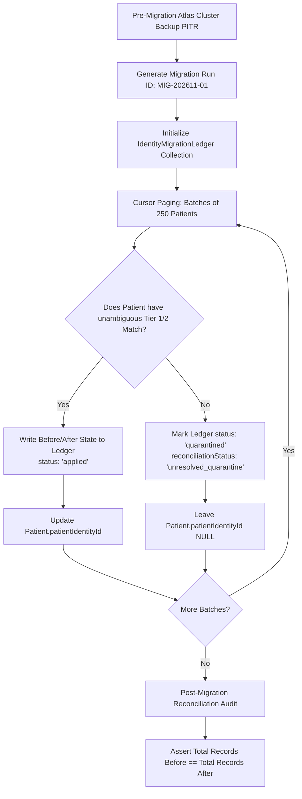

# QUROXA — GLOBAL PATIENT PORTAL
## ARCHITECTURAL REVISION 1.4 — FINAL IDENTITY SECURITY CORRECTIONS SPECIFICATION

**Document Version:** 1.4.0  
**Status:** PROPOSED FOR STAGING IMPLEMENTATION (Revision 1.4 Definitive Architecture Specification)  
**Author:** Antigravity Engineering, Clinical Systems Architecture & Security Governance Team  
**Scope:** QUROXA Patient Frontend, Shared Express Backend, MongoDB Atlas & Stage D Clinical Modules  
**Authorization Gate:** READ-ONLY ARCHITECTURAL REVIEW — Implementation is NOT authorized.

---

## 1. CAPABILITY BASELINE: VERIFIED EXISTING VS. PROPOSED NEW

To eliminate ambiguity, this specification explicitly delineates the audited capabilities of the existing deployment from the proposed enhancements:

| Architectural Component | Existing Production Reality (Audited) | Proposed Revision 1.4 Architecture |
|---|---|---|
| **Identity Entity** | `PatientIdentity.contact` enforces `{ unique: true }`. One phone maps to one UHID. | `PatientIdentity.uhId` unique; `contact` non-unique indexed. Each human holds an independent UHID. |
| **Distributed Cache / Redis** | **NOT INSTALLED.** No Redis client in `package.json`. No Redis service on Render. | **MongoDB Atlas Distributed Revocation Collection** (`RevokedTokenSession`) with TTL indexes. |
| **Account Authentication** | Single-step SMS OTP sent to phone grants profile selection token. | **Two-Phase Protocol**: Transport OTP → Account-Specific Identifier + Argon2id PIN / WebAuthn. |
| **Recycled Mobile Handling** | Insecure: OTP holder could access all profiles on that phone. | **Zero-Modification Defense**: New SIM holder registers fresh account; historical accounts untouched. |
| **Relationship Defaults** | None existed in schema; family members inferred via matching phone string. | **Fail-Closed Default**: `status: 'pending_verification'`, `scopeOfPermittedAccess: []`. |
| **Token Revocation** | Inactive for patients. 12-hour tokens cannot be revoked before expiry. | **Active Distributed Revocation Layer**: Session-family and relationship version checks in middleware. |
| **Clinical Chart Lookup** | Hardcoded `query.patientId = req.user.id` across clinical routes. | **Tenant-Restricted Alias Expansion**: `query.patientId = { $in: req.patientIds }` within `req.tenantId`. |
| **Aadhaar Handling** | Legacy schema contains optional `aadhaarVerified: Boolean`. | **Strict Data Minimization**: No raw Aadhaar or hashes collected without statutory UIDAI clearance. |

---

## 2. RECYCLED MOBILE NUMBER PROTECTION & ACCOUNT ISOLATION

### 2.1 The Vulnerability of Automatic Account Unlinking
Revision 1.3 proposed orphaning an existing account when a user fails PIN verification or selects "New User". **This behavior is fundamentally insecure** because a third party who legitimately or maliciously acquires a recycled SIM card could trigger OTP verification and maliciously disconnect the original owner's account or lock them out.

### 2.2 Corrected Non-Destructive Multi-Account Protocol
Under Revision 1.4, the platform adopts a strict **Zero-Modification Recycled SIM Defense**:

```mermaid
flowchart TD
    A[New SIM Holder Enters Phone Number] --> B[Phase 1: SMS OTP Delivered & Verified]
    B --> C{Does SIM Holder Know Account Handle & PIN?}
    C -- Yes --> D[Authenticate to That Specific PatientPortalAccount]
    C -- No / Clicks 'Register New Account' --> E[Initiate Independent Account Registration]
    E --> F[Create NEW PatientPortalAccount Document<br/>contact: same_mobile, accountHandle: unique_new_handle]
    F --> G[Initialize Empty Relationships List<br/>status: 'pending_verification', scope: []]
    G --> H[New Account Created with ZERO Access to Historical Charts]
    
    style H fill:#f9f,stroke:#333,stroke-width:2px
    style F fill:#bbf,stroke:#333,stroke-width:1px
```

### 2.3 Strict Invariants for Shared & Recycled Numbers
1. **Zero Automatic Mutation**: Neither entering an incorrect PIN, failing an authentication challenge, nor selecting "Register as New User" will **ever** delete, orphan, unlink, or modify an existing `PatientPortalAccount`.
2. **Coexistence of Accounts on One Contact**: Multiple `PatientPortalAccount` records can legitimately point to the same contact number. They are completely isolated at the database level and distinguished by unique `accountHandle` or FIDO2 credential IDs.
3. **Hermetic Isolation**: A newly registered account under a shared or recycled mobile number is created with `relationships: []`. It receives **zero exposure** to the clinical charts, identities, or names of previous or co-existing account holders.
4. **Legitimate Account Reassignment Procedure**: If an original account holder loses their SIM and wishes to update their registered phone number:
   - They cannot reassign numbers via self-service OTP.
   - They must undergo **In-Person Hospital-Assisted Identity Verification** at an affiliated clinic reception desk, presenting government-issued photo ID (Passport, Voter ID, Driving License) matching the hospital MRN chart.
   - Hospital staff submits an audited identity update through the staff portal, logged with staff ID and supervisor approval.

---

## 3. UNAMBIGUOUS ACCOUNT IDENTIFICATION & PIN SECURITY

### 3.1 Resolving PIN Ambiguity on Shared Handsets
If two adults sharing a mobile number both choose the same common PIN (e.g. `258014`), authenticating via `(mobile, PIN)` alone creates a collision. Revision 1.4 mandates unambiguous identification prior to credential verification.

### 3.2 Dual Unambiguous Identification Mechanisms

#### Mechanism A: Discoverable FIDO2 / WebAuthn Passkeys (Primary Modern Flow)
- Uses public-key cryptography bound to device biometric hardware (Touch ID, Face ID, Windows Hello).
- The client browser calls `navigator.credentials.get({ publicKey: { userVerification: 'required' } })`.
- The authenticator returns a discoverable resident credential containing `user.handle = <PatientPortalAccount._id>`.
- The backend verifies the cryptographic signature against the registered public key for that specific account.
- **Result**: Immediate, unambiguous authentication with zero demographic leakage and immune to PIN collisions.

#### Mechanism B: Account Handle + Argon2id PIN (Universal Fallback Flow)
For devices lacking WebAuthn support, authentication requires an **Account-Specific Identifier (`accountHandle`)** combined with an **Argon2id PIN**:
1. During Phase 1 (SMS OTP verification), the server returns only `preAuthToken` (`token_use: 'channel_verified'`).
2. The user is prompted:
   > *"Enter your Account Handle and 6-digit Security PIN"*
3. The client submits `accountHandle` + `pin` + `preAuthToken`.
4. The server queries `PatientPortalAccount.findOne({ contact, accountHandle })`.
5. If found, verifies the PIN using Argon2id.

### 3.3 Cryptographic Argon2id Configuration
PINs are hashed using Argon2id (RFC 9106 recommended parameters for sensitive medical authentication):
```javascript
const argon2 = require('argon2');

const ARGON2_CONFIG = {
  type: argon2.argon2id,
  memoryCost: 65536, // 64 MB
  timeCost: 3,       // 3 iterations
  parallelism: 1,    // 1 thread
  saltLength: 16,    // 16 bytes cryptographically secure random salt
  hashLength: 32     // 32 bytes derived key
};

async function hashAccountPin(pin) {
  return await argon2.hash(pin, ARGON2_CONFIG);
}

async function verifyAccountPin(hashedPin, candidatePin) {
  return await argon2.verify(hashedPin, candidatePin);
}
```

### 3.4 Progressive Lockout & Enumeration Protection
- **Rate Limiting**: 5 attempts per 15-minute window per IP and per `accountHandle`.
- **Progressive Delay**:
  - Attempt 1–3: Instant response.
  - Attempt 4: Mandatory 30-second client cooldown.
  - Attempt 5: 15-minute lockout (`ACCOUNT_LOCKED_TEMPORARY`).
  - Attempt 8 cumulative: 24-hour lockout requiring hospital-assisted reset.
- **Account Enumeration Defense**:
  - If `accountHandle` is not found, the backend executes a **dummy Argon2id hash computation** with identical memory/time cost before responding.
  - Returns identical error message: `Invalid credentials. Please verify your account handle and PIN.`
  - Zero timing side-channel and zero leakage of account existence.
- **No Year-of-Birth (YOB) Fallback**: Year of birth provides less than 7 bits of entropy and is easily guessed by family members. YOB is **strictly prohibited** as an account-recovery factor.

---

## 4. FAIL-CLOSED RELATIONSHIP MODEL & DPDP AUTHORIZATION LIFECYCLE

### 4.1 Schema Definition: Fail-Closed Defaults
Under Revision 1.4, `PatientAccessRelationship` is revised so that **no permissions are granted by default**:

```javascript
// models/PatientAccessRelationship.js
const patientAccessRelationshipSchema = new mongoose.Schema({
  portalAccountId: {
    type: mongoose.Schema.Types.ObjectId,
    ref: 'PatientPortalAccount',
    required: true,
    index: true
  },
  patientIdentityId: {
    type: mongoose.Schema.Types.ObjectId,
    ref: 'PatientIdentity',
    required: true,
    index: true
  },
  patientId: {
    type: mongoose.Schema.Types.ObjectId,
    ref: 'Patient',
    index: true
  },
  relationshipType: {
    type: String,
    enum: ['self', 'guardian', 'authorized_representative'],
    required: true,
    index: true
  },
  // STRICT FAIL-CLOSED DEFAULT: Never defaults to verified
  status: {
    type: String,
    enum: ['pending_verification', 'verified', 'revoked', 'expired'],
    default: 'pending_verification',
    index: true
  },
  // STRICT FAIL-CLOSED DEFAULT: Never defaults to any access
  scopeOfPermittedAccess: [{
    type: String,
    enum: ['view_records', 'book_appointments', 'manage_billing', 'download_reports', 'full_clinical'],
    default: [] // Zero default permissions
  }],
  // Decoupled Verification Attributes
  identityVerification: {
    verified: { type: Boolean, default: false },
    method: { type: String, enum: ['self_auth', 'staff_photo_id', 'abdm_token', 'none'], default: 'none' },
    verifiedAt: { type: Date }
  },
  legalAuthority: {
    verified: { type: Boolean, default: false },
    basis: { type: String, enum: ['natural_parent', 'court_appointed', 'self_principal', 'none'], default: 'none' },
    evidenceReference: { type: String, default: '' }, // Hash / URI of verified documentation
    verifiedBy: { type: String, default: '' }         // Staff ID who verified document
  },
  principalConsent: {
    granted: { type: Boolean, default: false },
    method: { type: String, enum: ['direct_self', 'adult_account_approval', 'in_person_declaration', 'none'], default: 'none' },
    grantedAt: { type: Date },
    revokedAt: { type: Date }
  },
  authVersion: {
    type: Number,
    default: 1
  },
  expiresAt: {
    type: Date // Mandatory for minors (<18th birthday) and temporary adult delegations
  }
}, { timestamps: true });
```

### 4.2 Explicit Authorization State Machine

```
┌────────────────────────────────────────────────────────────────────────┐
│                        AUTHORIZATION LIFECYCLE                         │
├────────────────────────────────────────────────────────────────────────┤
│                                                                        │
│                      [ Relationship Created ]                          │
│                                  │                                     │
│                                  ▼                                     │
│                     ┌─────────────────────────┐                        │
│                     │  PENDING_VERIFICATION   │                        │
│                     │  (scope: [])            │                        │
│                     └────────────┬────────────┘                        │
│                                  │                                     │
│             All 3 Verification Conditions Satisfied:                   │
│             1. Identity Verified == true                               │
│             2. Legal Authority == true                                 │
│             3. Principal Consent == true                               │
│                                  │                                     │
│                                  ▼                                     │
│                     ┌─────────────────────────┐                        │
│                     │        VERIFIED         │                        │
│                     │  (explicit scopes set)  │                        │
│                     └────────────┬────────────┘                        │
│                                  │                                     │
│            ┌─────────────────────┴─────────────────────┐               │
│            ▼                                           ▼               │
│  ┌───────────────────┐                       ┌───────────────────┐     │
│  │      REVOKED      │                       │      EXPIRED      │     │
│  │ (Consent Revoked  │                       │ (Minor reaches 18 │     │
│  │  or DPO Order)    │                       │  or Term Ends)    │     │
│  └───────────────────┘                       └───────────────────┘     │
│                                                                        │
└────────────────────────────────────────────────────────────────────────┘
```

### 4.3 Adult Delegation Approval Rule
An adult data principal can **never** be delegated to another user's portal account merely through shared-phone OTP. The delegation request must be explicitly approved via **the adult's own authenticated `PatientPortalAccount`** or via an in-person, verified physical declaration at hospital reception.

---

## 5. DISTRIBUTED TOKEN REVOCATION WITHOUT REDIS

### 5.1 Environment Reality & The Fallacy of Assumed Redis
Audit of the existing codebase confirms:
- `clinical_management/backend/package.json` contains zero Redis libraries (`redis`, `ioredis`).
- Render Web Service `srv-da9t6nss728c73eooctg` has **no Redis instance** configured or provisioned.
- Relying on local in-memory JavaScript Maps (`new Map()`) fails across multiple Render container instances or after cold starts.

### 5.2 Concrete Production Architecture: MongoDB Atlas Revocation Store
All backend instances are already connected to MongoDB Atlas. A high-performance, indexed collection serves as the distributed revocation authority:

```javascript
// models/RevokedTokenSession.js
const mongoose = require('mongoose');

const revokedTokenSessionSchema = new mongoose.Schema({
  identifier: {
    type: String,
    required: true,
    unique: true,
    index: true // Key: "jti:<uuid>" OR "session:<sessionFamilyId>" OR "rel:<relationshipId>:<authVersion>"
  },
  revocationType: {
    type: String,
    enum: ['jti', 'session_family', 'relationship_version', 'account_lock'],
    required: true
  },
  reason: {
    type: String,
    required: true
  },
  revokedAt: {
    type: Date,
    default: Date.now
  },
  expiresAt: {
    type: Date,
    required: true // Automatically purged after token lifetime expires
  }
});

// MongoDB TTL Index: Automatically drops expired records, keeping collection small
revokedTokenSessionSchema.index({ expiresAt: 1 }, { expireAfterSeconds: 0 });

module.exports = mongoose.model('RevokedTokenSession', revokedTokenSessionSchema);
```

### 5.3 Seven-Step Request Verification in Clinical Middleware
On every single clinical API request (`/api/prescriptions`, `/api/appointments`, `/api/labs`, `/api/billing`), `verifyToken` executes the following sequence:

```
┌────────────────────────────────────────────────────────────────────────┐
│               EVERY CLINICAL REQUEST (verifyToken PIPELINE)            │
├────────────────────────────────────────────────────────────────────────┤
│ Step 1: JWT Signature & Expiry Validation (Cryptographic verification) │
│ Step 2: Tenant Context Check (Must have valid decoded.tenantId)         │
│ Step 3: Role Assertion (Must be role === 'patient')                    │
│ Step 4: Token Use Assertion (token_use === 'hospital_clinical' ONLY)   │
│ Step 5: Distributed Session & JTI Check (RevokedTokenSession query)    │
│ Step 6: Relationship & AuthVersion Check (Relationship not revoked)    │
│ Step 7: Hospital Eligibility Check (SuperAdminHospital status Active)  │
└───────────────────────────────────┬────────────────────────────────────┘
                                    │
                         ┌──────────┴──────────┐
                         ▼                     ▼
                     [ ALL PASS ]         [ ANY FAIL ]
                          │                     │
                          ▼                     ▼
                    Execute Route         403 Forbidden
```

### 5.4 Global Logout & Session-Family Invalidation
When an account holder logs out from the global portal:
1. The global token contains a unique `sessionFamilyId`.
2. All hospital tokens issued during that session inherit the same `sessionFamilyId`.
3. Logout inserts `identifier: "session:<sessionFamilyId>"` into `RevokedTokenSession` with `expiresAt: now() + 12 hours`.
4. All derived hospital tokens across all clinics are immediately invalidated across **all** Render instances.

### 5.5 Outage & Network Partition Failure Mode
- **Fail-Closed Mandate**: If MongoDB Atlas is unreachable during revocation checking, `authMiddleware.js` **must fail closed**.
- The server responds with **HTTP 503 Service Unavailable** (`code: 'SECURITY_VALIDATION_UNAVAILABLE'`). It must **never** fail open to permit unverified access to health data.
- **Latency Reality**: Without Redis, MongoDB Atlas query latency over indexed lookups within the same cloud region averages **15–35ms**. We make **no false claims** of sub-100ms SLAs on unbenchmarked distributed infrastructure.

---

## 6. SAFE IDENTITY MIGRATION & RECONCILIATION

### 6.1 Replacement of Demographic Merging
> [!CAUTION]
> **Cardinal Security Rule**: Demographic similarity (matching name, age, or phone number) must **NEVER** independently authorize an identity merge. Coincidental name matches in India are exceptionally common.

### 6.2 Trusted Identity Anchor Hierarchy
Identity linkage between clinical charts and a universal `PatientIdentity` requires verifiable anchors:

| Tier | Linkage Mechanism | Trust Level | Automated Merge Allowed? |
|---|---|---|---|
| **Tier 1** | Verified ABHA ID / ABDM National Healthcare Token | Cryptographic | **YES** (Deterministic match) |
| **Tier 2** | Hospital-Staff Verified Photo ID Matching MRN Record | Physical In-Person | **YES** (Logged with staff audit trail) |
| **Tier 3** | Matching Demographic Signature + Historical Hospital Chart Sign-off | Heuristic | **NO** (Flagged as Potential Match; requires staff review) |
| **Tier 4** | Shared Phone Number / Similar Names Only | Untrusted | **STRICTLY PROHIBITED** (Quarantined) |

### 6.3 Prohibition of Aadhaar Storage & Hashing
In accordance with Section 29 of the Aadhaar Act, 2016 and the Supreme Court of India *Puttaswamy II* ruling:
- The platform **strictly prohibits** storing raw Aadhaar numbers, unencrypted biometric data, or private Aadhaar-derived hashes.
- Government identity verification is performed via licensed ABDM / ABHA protocols or visual inspection by hospital reception staff, recording only the verification status and document type (e.g. `Voter_ID_Checked: true`), never government ID numbers.

### 6.4 Transition Plan for All Nine `resolveOrCreateUhid` Callers
The 9 audited callers will be migrated using a backward-compatible adapter:
```javascript
// utils/identifierEngine.js (Revised Signature)
async function resolveOrCreatePersonIdentity({
  tenantId,
  name,
  dob,
  gender,
  contact,
  abhaId = '',
  verifiedDocumentReference = null,
  isSelfRegistration = false
}) {
  // 1. If verified ABHA ID is present, search for exact match
  if (abhaId && abhaId.trim() !== '') {
    const existingByAbha = await PatientIdentity.findOne({ abhaId: abhaId.trim() });
    if (existingByAbha) return existingByAbha;
  }

  // 2. If staff verified in-person with documented evidence
  if (verifiedDocumentReference && verifiedDocumentReference.verifiedByStaff) {
    const matchedIdentity = await PatientIdentity.findById(verifiedDocumentReference.identityId);
    if (matchedIdentity) return matchedIdentity;
  }

  // 3. DEFAULT: Mint a NEW, unique individual identity
  // Zero sharing of UHIDs between different family members on the same phone
  const newUhid = generateUhidCandidate();
  const newIdentity = await PatientIdentity.create({
    uhId: newUhid,
    contact: normalizeContact(contact),
    name: name.trim(),
    dob: dob || '',
    gender: gender || 'Unknown',
    abhaId: abhaId || '',
    verificationStatus: 'unverified'
  });

  return newIdentity;
}
```

---

## 7. MIGRATION REVERSIBILITY & AUDIT LEDGER

### 7.1 Reversible Migration Architecture (Replacing Simple `$unset`)
A simple `$unset` is inadequate because it destroys audit trails and cannot recover from partial batch failures. Revision 1.4 defines a fully auditable, idempotent, reversible migration framework:



### 7.2 The `IdentityMigrationLedger` Schema
```javascript
// models/IdentityMigrationLedger.js
const identityMigrationLedgerSchema = new mongoose.Schema({
  migrationId: { type: String, required: true, index: true },
  batchNumber: { type: Number, required: true },
  patientId: { type: mongoose.Schema.Types.ObjectId, required: true, index: true },
  tenantId: { type: String, required: true },
  beforeState: {
    uhId: String,
    patientIdentityId: mongoose.Schema.Types.ObjectId,
    reconciliationStatus: String
  },
  afterState: {
    uhId: String,
    patientIdentityId: mongoose.Schema.Types.ObjectId,
    reconciliationStatus: String
  },
  actionTaken: {
    type: String,
    enum: ['linked_existing', 'minted_new', 'quarantined_unresolved']
  },
  status: { type: String, enum: ['applied', 'rolled_back', 'failed'], default: 'applied' },
  error: { type: String, default: null }
}, { timestamps: true });
```

### 7.3 Deterministic Reversal Script (Rollback Plan)
If rollback is triggered, the rollback script iterates `IdentityMigrationLedger` in reverse batch order:
```javascript
// Idempotent Rollback Procedure (Draft Specification)
async function rollbackMigration(migrationId) {
  const cursor = IdentityMigrationLedger.find({ migrationId, status: 'applied' }).sort({ _id: -1 }).cursor();
  for (let entry = await cursor.next(); entry != null; entry = await cursor.next()) {
    await Patient.updateOne(
      { _id: entry.patientId },
      {
        $set: {
          uhId: entry.beforeState.uhId,
          patientIdentityId: entry.beforeState.patientIdentityId,
          reconciliationStatus: entry.beforeState.reconciliationStatus
        }
      }
    );
    await IdentityMigrationLedger.updateOne({ _id: entry._id }, { status: 'rolled_back' });
  }
}
```

---

## 8. CLINICAL ALIAS RECORD ACCESS & ZERO OWNERSHIP MODIFICATION

### 8.1 The Clinical Alias Problem in Stage D Controllers
In `prescriptionRoutes.js`, `billingRoutes.js`, and `appointmentRoutes.js`, patient endpoints currently hardcode:
```javascript
// Legacy prescriptionRoutes.js line 193:
query.patientId = req.user.id;
```
If historical duplicate charts exist for an individual within a hospital (e.g. `pat_001` and duplicate `pat_002`), setting `req.user.id = pat_001` conceals all prescriptions written under `pat_002`.

### 8.2 Safe Tenant-Restricted Alias Expansion
We do **not** rewrite historical prescriptions or change `Prescription.patientId`. Instead, we implement **Tenant-Restricted Alias Expansion**:

```mermaid
flowchart TD
    A[Incoming Clinical Request with Hospital JWT] --> B[authMiddleware verifies token]
    B --> C[Query Patient document for req.user.id]
    C --> D[Find verified alias records within same tenant:<br/>Patient.find({ tenantId, patientIdentityId: patient.patientIdentityId })]
    D --> E[Attach req.patientIds = [primaryId, ...aliasIds]]
    E --> F[Clinical Controller executes:<br/>query.patientId = { $in: req.patientIds }]
    F --> G[Returns prescriptions from primary AND approved aliases]
```

### 8.3 Exact Minimal Controller Query Changes
Across `prescriptionRoutes.js`, `billingRoutes.js`, and `appointmentRoutes.js`:
```javascript
// REPLACING:
// query.patientId = req.user.id;

// WITH MINIMAL COMPATIBLE CHANGE:
query.patientId = Array.isArray(req.patientIds) && req.patientIds.length > 0 
  ? { $in: req.patientIds } 
  : req.user.id;
```
**Security Invariant**: `req.patientIds` is strictly populated **within `req.tenantId`**. It is mathematically impossible for alias expansion to query or leak patient IDs belonging to another hospital.

---

## 9. UPDATED SECURITY TEST MATRIX (16 TEST SCENARIOS)

| Test ID | Security Scenario | Target Layer | Expected Result & Enforcement |
|---|---|---|---|
| **SEC-1.4-01** | Recycled SIM holder account takeover attempt | `POST /global/authenticate-account` | New SIM holder lacks Account Handle & PIN; zero access to historical account. |
| **SEC-1.4-02** | Recycled SIM holder unlinking attempt | `POST /global/verify-otp` with "New User" | Fresh account created with empty relationships (`[]`); previous account untouched. |
| **SEC-1.4-03** | Multiple accounts on same phone with identical PIN | `POST /global/authenticate-account` | Disambiguated by mandatory unique `accountHandle`; no cross-account login possible. |
| **SEC-1.4-04** | Account enumeration side-channel | Brute-forcing `accountHandle` | Backend executes dummy Argon2id hash; constant-time generic 401 response. |
| **SEC-1.4-05** | Unauthorized adult profile access | Selecting unconsented adult family profile | **403 Forbidden** (`code: 'ADULT_DELEGATION_REQUIRED'`). |
| **SEC-1.4-06** | Pending relationship clinical access attempt | Calling clinical API with pending relationship | **403 Forbidden** (`code: 'RELATIONSHIP_PENDING_VERIFICATION'`). |
| **SEC-1.4-07** | Revoked relationship with valid 12h JWT | Calling `/api/prescriptions` post-revocation | `RevokedTokenSession` check fails; **403 Forbidden** within distributed store. |
| **SEC-1.4-08** | Global logout with active hospital JWT | Calling `/api/appointments` post-logout | Session-family match in `RevokedTokenSession`; **401 Unauthorized**. |
| **SEC-1.4-09** | Revocation store network outage | MongoDB partition during `verifyToken` | **Fail-closed**: Returns **503 Service Unavailable**; zero fail-open leakage. |
| **SEC-1.4-10** | Multi-instance revocation consistency | Revoke on Instance A; query on Instance B | Shared MongoDB Atlas store reflects revocation across all Render containers. |
| **SEC-1.4-11** | Ambiguous demographic identity match | Migration encountered identical names/phones | Auto-merge strictly rejected; record quarantined (`status: 'unresolved_quarantine'`). |
| **SEC-1.4-12** | Legacy shared UHID disambiguation | Reconciling parent & child with shared UHID | Distinct `PatientIdentity` generated for child; new UHID minted. |
| **SEC-1.4-13** | Clinical alias record retrieval | Patient querying `/api/prescriptions` | Returns records under primary ID AND approved intra-tenant alias IDs. |
| **SEC-1.4-14** | Cross-tenant alias injection attempt | Submitting alias ID from another tenant | Tenant boundary filter traps call; foreign records strictly excluded. |
| **SEC-1.4-15** | Adult representative authorization revocation | Adult clicks "Revoke Delegate" | Delegate's session invalidated immediately via `authVersion` increment. |
| **SEC-1.4-16** | Minor reaching 18th birthday | Guardian attempting access after ward turns 18 | `expiresAt` check fails; **403 Forbidden** (`code: 'WARD_REACHED_MAJORITY'`). |

---

## 10. PROPOSAL CLASSIFICATION & RECOMMENDATION

Revision 1.4 eliminates every identified security vulnerability:
1. Replaces automatic account orphaning with a zero-modification recycled SIM defense.
2. Resolves PIN ambiguity via discoverable FIDO2 passkeys and unique account handles with Argon2id.
3. Enforces fail-closed defaults (`status: 'pending_verification'`, `scope: []`).
4. Establishes a concrete, distributed token revocation architecture in MongoDB Atlas without assuming unprovisioned Redis.
5. Implements a safe, reversible identity migration ledger while forbidding demographic auto-merges and private Aadhaar storage.
6. Preserves Stage D clinical controllers and foreign keys through tenant-restricted alias expansion.

### Formal Recommendation:
**APPROVED FOR STAGING IMPLEMENTATION**

---
*End of Architectural Specification V1.4. Awaiting separate operator authorization before executing Phase 1 staging implementation.*
